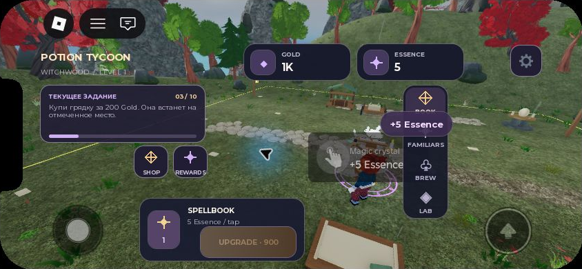
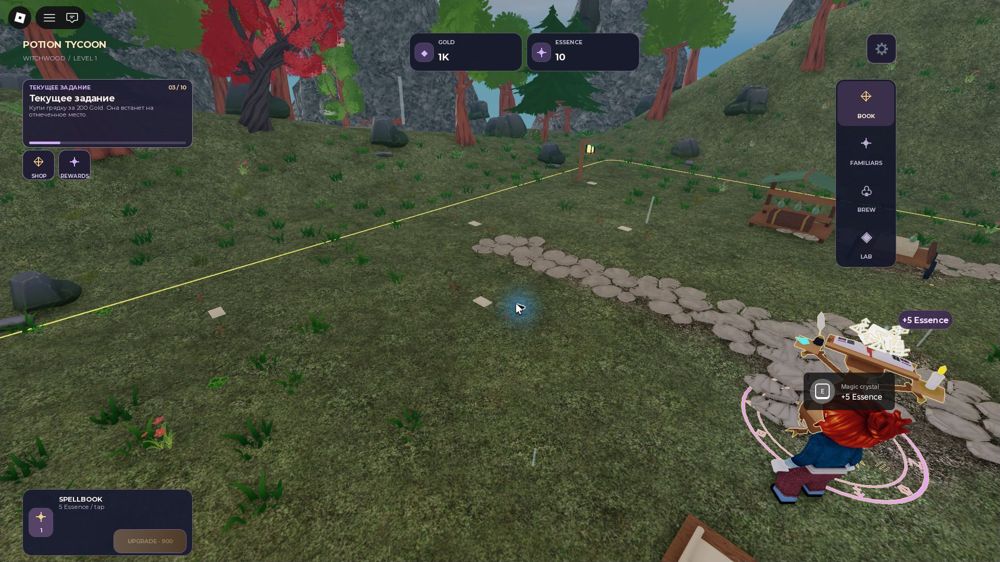

# AG-64 — native Landscape Gameplay HUD

Status: **IMPLEMENTED/CODE; scoped STUDIO VERIFIED; OWNER ACCEPTED: NO;
PUBLISHED: NO.** No merge, game publication, asset upload, trading or payments.

## Revision and scope

- Branch: `feat/ag64-landscape-hud`.
- Stacked [Draft PR #35](https://github.com/branch-danya-dev/magicpotiongacha/pull/35),
  targeting `feat/ag63-postfx-lookdev` (Draft PR #34).
- Exact requested base: `0457a87b5cbff1200d1e96889986198244918213`.
  Base Windows/Ubuntu [CI 43243560877](https://github.com/branch-danya-dev/magicpotiongacha/actions/runs/43243560877) passed before implementation.
- Final runtime source: `99534d7ba1b9342eacb0cf19570369a798987f27`.
  Subsequent delivery changes contain this report/evidence only. Final delivery
  HEAD and its exact-HEAD Windows/Ubuntu run are recorded in PR #35.
- Design: [Figma 7:21](https://www.figma.com/design/4Qfq1mf8p4oNLVqQH85yfI?node-id=7-21),
  approved 844 × 390 landscape frame. Owner's explicit AG-64 request authorizes
  this HUD slice; it does not select an AG-63 lighting preset.

`LandscapeHUD.luau` mounts native Frames, TextLabels, UIStroke, UICorner,
UIGradient and existing Kit buttons inside the existing `PotionTycoonUI`.
`shared/ui/Landscape.luau` projects snapshots and computes safe bounds.
Main remains the single state/action owner. No duplicate State subscription,
ScreenGui, React/HTML, full-screen picture, remote or saved field was added.
The Figma forest, pedestal and book illustration are not GUI assets.

Existing server sources, profile contracts, economy, first-session mechanics,
Spellbook model/VFX, environment/PostFX and asset files are unchanged.
The preservation check compares all inherited source/test files and the Rojo
project against the base, allowing only explicit removable HUD integration
blocks in Main and the Studio foundation demo. The old demo no longer obscures
the live HUD by default. Internal windows retain their existing contents.

## Connected controls and data

| HUD element | Existing source / action | Native verification |
| --- | --- | --- |
| Gold / Essence | `state.gold`, `state.essence`; existing compact number formatting | Server balances update after clicks, sales and upgrade |
| Quest / progress | `state.tutorial.text/step/total/complete` | Starter choice and first-click steps update; quest opens existing guide |
| Book level | `state.stations.crystal.level` | Actual L1 → L2 update |
| Per tap | `state.longTerm.manualClickEssence` | Current server value 5; tests also use non-demo value 7 |
| Upgrade | `state.builds.crystal`; existing `send("buy", {upgradeId="crystal"})` | Actual GUI click spends 900 Gold, L2; next offer 4500 |
| Book | Existing `crystal` section | Opens Magic crystal |
| Familiars | Existing `altar` section | Opens collection/altar |
| Brew | Existing `cauldron` section | Opens cauldron/recipes |
| Lab | Existing `blueprint` section | Opens laboratory progression |
| Shop | Existing resource/seed shop `supplies` | Opens 20/100 Gold seed offers |
| Rewards | Existing `dailies` section | Opens daily rewards |
| Settings | Existing `quality` section | Opens environment quality controls |

Upgrade fails closed while loading, read-only, pending, unavailable, unaffordable,
at maximum level or with an invalid offer. Existing request IDs, expected-level
checks and server validation remain in force. No local currency change occurs.

The local `+N Essence` label consumes the existing owned-plot, increasing server
receipt sequence. Initial snapshots, passive income, rejected/replayed requests
and another plot do not produce it. **At the balance cap it is suppressed**:
the existing receipt has no exact granted amount for a partial capped reward.
One reusable label expires after 1.1 seconds; repeated receipts extend that label
instead of creating objects. One temporary Heartbeat connection tracks its book
anchor; it disconnects on expiry, disabled HUD, missing anchor or destruction.
The inherited pre-confirmation click toast and balance-delta toast are suppressed
only while the new HUD is active. Existing Spellbook VFX remain independent.

## Figma comparison and responsive choices

| Reference | Native implementation |
| --- | --- |
| Dark violet/slate translucent cards, cream text, lilac Essence, gold action | Isolated Soul-derived palette; resource `#171A2B`, book `#191D2F`, dock `#141728`; gold gradient `#FFE4AC` → `#C99C60` |
| Montserrat / Inter hierarchy | Existing Roblox Gotham/GothamBold analogues; compact labels, stronger title/balances |
| Rounded 13–17 px surfaces and fine borders | Native UICorner/UIStroke, preserved contrast and proportions |
| Title upper left; two counters centered; settings upper right | Same hierarchy within CoreUISafeInsets; narrow safe widths may hide redundant title |
| Quest left; Shop/Rewards below; book lower left; four-item right rail | Same grouping; phone lower card moves right of the joystick and tablet card moves above its larger footprint |
| Small magical icons | Native text/geometric marks, including four-point stars absent from Roblox font glyphs; no external texture upload |
| Decorative background | Actual unchanged game world; no imitation scene in ScreenGui |

The reference's absolute coordinates are deliberately adapted to Roblox's safe
areas. A notched 844 × 390 phone exposes 750 × 332 HUD space. A custom 740 × 360
iOS profile exposes 740 × 282 after its status bar and CoreGui. The latter uses a
shorter quest card with two lines of instructions and the same accessible guide.
Buttons remain at least 44 × 44. Desktop UI scales up to 1.25× and reserves the
right-side player-list area. Existing chat bounds/polling are retained: on touch,
opening native chat hides the game HUD and closing it restores it; CoreGui is
never disabled or repositioned. A transition may take the inherited 0.5s poll.

Mouse/touch use the same Activated controls. Gamepad selection order, explicit
up/down links and B-to-close are implemented; physical controller testing is
still open. Portrait/narrow windows use the inherited HUD.

## Local validation

`npm run tools` and `npm test`: PASS. Pinned tools/actions preserved.

| Suite | Passed / failed |
| --- | --- |
| Existing domain and persistence | 1142 / 0 |
| Existing AG-01 | 13 / 0 |
| Existing AG-62A/R1 | 26 / 0 |
| Existing AG-63 | 12 / 0 |
| New AG-64 | 26 / 0 |
| **Total** | **1219 / 0** |

189 Luau sources compile; portable analysis and existing asset/integration
guards pass. Existing LocalShadow/LocalUnused warnings remain in inherited code.
New tests cover real snapshot projection, fail-closed offers, receipt ownership/
replay/cap behavior, routes, rollback decisions, safe bounds, button sizes,
touch controls, chat reservation and native book-prompt clearance.

Two independent default Rojo builds are byte-identical:

```text
build/AG64-review-final.rbxlx
build/PotionTycoon.rbxlx
SHA-256 8af10476830037f0a12246bac2fd2452464fae637e30935a2bc8165b2752268e
```

The ordinary game and pilot project both build with sourcemaps. The review file
was opened directly in Roblox Studio and run with F5, not a separate UI demo.
CI repeats tools, tests, ancestry and the ordinary build on both Windows and
Ubuntu. Final run link/status are in [PR #35](https://github.com/branch-danya-dev/magicpotiongacha/pull/35).

## Ordinary Studio Play evidence

Windows Studio `0.747.0.7471481`, 2026-11-12, existing `STUDIO_MEMORY` server mode,
default Reduced environment, native Q21 emulator rendering. No live DataStore
or profile edits. `scripts/studio-ag64-play.luau` is an optional local diagnostic
helper; it is excluded from Rojo and uses only existing validated intents.

| Check | Observation |
| --- | --- |
| Ordinary startup | Live game, single new HUD, existing starter chooser preserved |
| Native tap/click on 3D book prompt at 844 × 390 | Essence 0 → 5, receipt sequence 1, local +5 label |
| Native E at 1920 × 1080 | Essence 5 → 10, sequence 2, local +5 label |
| Seven menu buttons | All open their existing sections, with functioning existing close/scroll behavior |
| Real upgrade | Existing planting/harvesting/two Healing sales earn 900 Gold; actual HUD Upgrade click gives Gold 0, book L2, next cost 4500; next purchase disabled |
| Twenty rapid validated click requests | Server rate limiting remains active; 13 accepted in this burst; 125 HUD descendants unchanged; label expires |
| Out-of-range rejected click | Receipt unchanged, no success label |
| Quality | Full/Reduced/Minimal × Reduce Motion off/on: all six combinations retain HUD; restored Reduced/off |
| Rollback | Twenty legacy/new cycles: one mounted HUD, correct legacy bars restored, no accumulated view |
| Native chat | Touch HUD yields to open chat and returns after close; book/touch controls stay available after restoration |
| 844 × 390 | iPhone 13 notch/CoreGui/joystick/jump and native book interaction checked |
| 740 × 360 | Custom iOS profile, additional 20px status-bar reserve; corrected Shop/Rewards versus book overlap verified |
| 1024 × 768 | iPad 6th generation; corrected larger joystick clearance verified in final build |
| 1366 × 768 | Native Average Windows profile; layout visually checked |
| 1920 × 1080 | Native HD1080 profile; layout, book E and performance sample checked |

The initial ordinary build `251a20641cde8a3845aeadf4711545a5fc88e02a` supplied
the menu/upgrade check. Build `f5242a55e9886976fd9c4ed93a901f93fe75da31`
supplied native tap/E captures, burst/rejection and cadence checks. Final runtime
`99534d7ba1b9342eacb0cf19570369a798987f27` fixes tablet and extra-short phone
spacing and was freshly rebuilt/reopened for those views, six quality/motion
checks and another twenty rollback cycles. These final layout-only changes do
not alter 844 × 390 or desktop placement. Captures are attributed to their actual
builds, not retroactively labeled as final HEAD.

### Native screenshots

Actual Studio captures, no generation, recoloring or visual enhancement. PNGs
below are unscaled pixel crops of the device viewport; original full-window JPEGs
are retained beside them. [Manifest](evidence/ag64/manifest.json) records hashes,
source SHA and crop coordinates. [Filtered QA log](evidence/ag64/studio-qa.log)
contains only AG-64 diagnostics and relevant inherited M7 asset-load errors.

844 × 390, native tap +5:



1920 × 1080, native E +5:



Additional full-window evidence: [740 × 360](evidence/ag64/studio-740x360-window.jpg),
[1024 × 768](evidence/ag64/studio-1024x768-window.jpg),
[1366 × 768](evidence/ag64/studio-1366x768-window.jpg).

### Bounded desktop performance observation

Same camera, 1920 × 1080, Reduced, native Q21; three seconds per sample:

| View | Frames | Median frame interval | P95 frame interval |
| --- | --- | --- | --- |
| New HUD | 181 | 16.712 ms | 18.154 ms |
| Legacy HUD | 181 | 16.612 ms | 18.029 ms |
| New HUD repeat | 181 | 16.598 ms | 17.873 ms |

This is RenderStepped frame cadence (~60 fps), **not isolated GPU/render cost**.
No obvious degradation appeared in this short desktop sample. It does not prove
phone performance, long-session behavior or a full performance acceptance gate.

## Reproduce and rollback

1. Check out the feature HEAD, run `npm run tools`, then `npm test`.
2. Open `build/PotionTycoon.rbxlx` in Studio; F5 ordinary Play. Use memory mode for
   test transactions. Choose a starter, interact with the actual book, then use
   existing gameplay to unlock/earn the first upgrade.
3. Select device profiles listed above. Test navigation, quest, safe areas and
   the unchanged Settings quality/motion controls.
4. In the **client** Command Bar, `workspace:SetAttribute("LandscapeHUDEnabled",false)`
   restores legacy UI; `true` restores the landscape HUD. To inspect legacy game
   UI without the optional inherited Studio foundation demo, also set
   `workspace:SetAttribute("UIFoundationDemo",false)` locally.
5. Stop Play. Do not save the diagnostic camera/avatar mutations or publish.

## Remaining limitations / gates

- Owner visual acceptance of this adaptation is open. Compact text and native
  substitute icons need that review; this is not a pixel-identical Figma export.
- Real smartphone/tablet, physical gamepad, real backend/rejoin and 2–8 real
  clients: NOT RUN. Emulator touch is not a real-device result.
- Internal shop/collection/brewing windows retain the old design and scrolling;
  their redesign is outside AG-64. Portrait remains legacy.
- Numerical Essence feedback is intentionally omitted for capped/partial grants.
- The inherited M7 local `rbxasset://m7...` sky/effect images report load failures
  in this Studio installation. The HUD introduces no image assets. This existing
  asset integration/permission gate remains open; global lighting was untouched.
- No new AG-64 runtime error was observed in the exercised paths. This is not a
  claim of a clean global Studio log or full release readiness.
- No merge, publication, final PostFX selection or next UI stage is implied.
