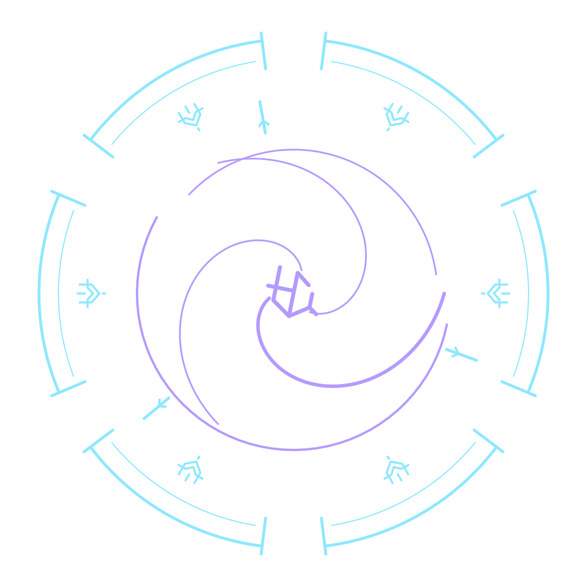

# AG-67 — Soul Absorption, Stage A art review

**IMPLEMENTED/CODE:** isolated Stage A prototype. **STUDIO VERIFIED:** the scoped checks below.
**OWNER ACCEPTED:** pending. **PUBLISHED:** no. Stage B is blocked by the owner's explicit art gate.

Base: Draft [PR #35](https://github.com/branch-danya-dev/magicpotiongacha/pull/35),
`feat/ag64-landscape-hud` @ `d026c02a3aa56b87e0883d6c9aac0f0854a81cb1`.
Its HEAD was rechecked before delivery; Windows/Ubuntu
[CI 43263392408](https://github.com/branch-danya-dev/magicpotiongacha/actions/runs/43263392408) passed.
Feature: `feat/ag67-soul-absorption-prototype`, stacked on that branch, not `main`.
The delivery PR records the exact feature HEAD and its Windows/Ubuntu CI results.

## Review the art first



- [Idle runes, close camera — 12 seconds](evidence/ag67/idle-close-full.mp4).
- [Full ritual and repeat confirmations, close camera — 13.5 seconds](evidence/ag67/ritual-close-full.mp4).
- [Idle, wider camera — 12 seconds](evidence/ag67/idle-full.mp4).
- [Ritual, wider camera — 13.5 seconds](evidence/ag67/ritual-full.mp4).
- [Editable SVG](../assets/vfx/ag67/SoulAbsorptionSigil.svg),
  [authored path vocabulary](../assets/vfx/ag67/design.json),
  [texture provenance and hashes](../assets/vfx/ag67/manifest.json).

All four videos are native Studio F12 captures from ordinary full-game Play,
not renders, generated frames or post-composited VFX. Only time trimming,
uniform resizing and H.264 encoding were applied. Raw recordings remain local;
their hashes, clip offsets, cameras and runtime hashes are in the
[capture manifest](evidence/ag67/manifest.json). HUD panels and proximity prompts
were temporarily hidden for art recording. The existing `EnvironmentReview=day`
locked the lighting; no Lighting implementation changed. Camera, HUD, prompts,
weather and original VFX were restored, then Play was stopped.

The close camera makes the glyphs and page folding easier to assess. The wider
camera is deliberately retained: thin sigil lines and soul cores are less legible
against the bright grass at that distance. This remains an art-review concern.

## What the prototype demonstrates

- Six separated receiving sectors, an asymmetric inner spiral, three inward
  channels and four original glyphs with meanings: Receive, Conduct, Release,
  Bind. Geometry is authored in `build-ag67-art.mjs`, with editable SVG and
  transparent PNG output. No stock circle, font glyph set or pentagram is used.
- Independently moving cyan/lilac runes, different phases/directions/radii,
  individual rotation and glow. A filtered, integrated speed boost avoids a
  position jump after a receipt. Ring layers rotate at separate slow speeds.
- A 2.4-second ritual: sequential sector pulses, pale-core cyan/violet soul
  ribbons, an absorption pulse at the chest, and folding/tumbling pages that
  brighten at their edges, darken, shrink and fade above the floor.
- Beams use Attachments and sample the current character chest every update.
  The pure rig lookup supports R6/R15; actual native capture used R15 only.
- A single shared ritual pool coalesces overlapping receipts. Each accepted
  receipt refreshes the book/sigil pulse; it does not extend the batch or add
  another collection of pages/emitters. No effect is triggered directly by input.

Page burning is a **prototype approximation**: torn parchment texture, two folded
panels, an ember/violet edge overlay, darkening, shrinking and shared ash particles.
It is not a finished progressive erosion/flame shader. The owner should judge
that treatment, the rune scale, stream thickness and seal contrast before Stage B.

## Isolation and reproduction

No inherited production source, test, model, asset or `default.project.json` changed.
`scripts/check-ag67.mjs` verifies their contents against the exact base above.
The ordinary Rojo output is byte-identical to the base:
`8af10476830037f0a12246bac2fd2452464fae637e30935a2bc8165b2752268e` (SHA-256).
This includes economy, saves, remotes, server validation, imported geometry,
interaction anchors, global lighting and existing VFX.

`qa/ag67/Adapter.luau` is mapped **only** by the generated QA project. It stops
the previous effects owner before starting the other one. New VFX defaults OFF;
ordinary release builds do not contain the adapter or prototype modules at all.
The prototype consumes the unchanged `SpellbookFeedback` server receipt, checks
writability/owned plot/ready model/live character, and never sends gameplay intents.
The separate Command Bar recording helper sends normal server-validated click
intents; it is not mapped into either game build.

From a clean feature checkout:

```text
npm run tools
npm test
node scripts/build-ag67-art.mjs
node scripts/build-ag67-preview.mjs
node scripts/install-ag67-preview.mjs "<installed Roblox version directory containing RobloxStudioBeta.exe>"
```

The final command verifies and installs nine small local PNGs into
`content/ag67-soul-v2/` of the selected Studio version. It rejects changed existing
files and path escapes. No Roblox asset ID, group access grant or cloud upload is
created. Studio updates may require reinstalling into the new version directory.
For a published implementation, asset permissions and preloading must be designed
and tested in Stage B after approval; these local paths are a preview mechanism.

Open `build/AG67-Prototype.rbxlx`, use ordinary Play, and wait for the imported book.
In the **client** Command Bar:

```lua
local b = game.Players.LocalPlayer.PlayerScripts.PotionTycoon.SpellbookEffects.ArtPreview
b:Invoke("mode", "prototype") -- original is the default and rollback
b:Invoke("quality", "full") -- reduced / minimal also supported
b:Invoke("motion", false) -- true enables Reduce Motion
print(b:Invoke("inspect"))
```

For deterministic framing, paste `qa/ag67-review-command-bar.luau`. Then
`_G.AG67Review.prepare("full", true)` selects the close camera (omit `true` for wide),
`_G.AG67Review.ritual()` requests clicks at 3, 6, 9 and 9.18 seconds through the
unchanged server, and `_G.AG67Review.restore()` restores the captured settings.
The helper requires Studio, a local PlaceId 0 file and a loaded owned book.
Record with Studio's native F12 control. Do not run the helper in a live experience.

The captured `AG67-ArtReview.rbxlx` and fresh `AG67-Prototype.rbxlx` match exactly:
`63bff6a3562fbb2719d10342a441301d4f766fe3a0b0143b26eb1bf980687adc`.
Capture happened before the final Git commit; the manifest records the exact
runtime file hashes and build hash, not a falsely attributed pre-existing commit.
Later documentation and Command Bar helper refinements do not enter that build.

## Explicit prototype budgets

These are new art budgets, **not** an assertion of mobile performance acceptance.
Legacy paper counts were 5/3/0 (Full/Reduced/Minimal); the prototype uses the
requested larger bursts and costs substantially more in local objects.

| Limit, per client | Full | Reduced | Minimal | Full + Reduce Motion |
|---|---:|---:|---:|---:|
| Active nearby books | 2 | 1 | 1 | 2 |
| Runes per active book | 6 | 4 | 2 | 6 static |
| Pooled pages, total | 22 | 12 | 4 | 0 |
| Two-panel page Parts | 44 | 24 | 8 | 0 |
| Soul streams / Beam objects | 3 / 18 | 2 / 12 | 1 / 6 | 0 / 0 |
| Rate-zero shared emitters | 3 | 3 | 3 | 3, unused |
| Sparks emitted per batch | 28 | 14 | 4 | 0 |
| Local shadowless lights | 1 | 1 | 0 | 1, gentle pulse |
| Maximum update rate | 60 Hz | 30 Hz | 20 Hz | 60 Hz |
| Distance limit, studs | 100 | 72 | 32 | 100 |
| Native observed descendants | 429 | 228 | 95 | 91 |

At most eight book references are tracked; owned plot has priority. No new
MeshParts, physics collisions or per-page tasks. One Heartbeat, one State listener
and one adapter attribute listener; no new remotes. Runtime raster textures total
3.75 MiB decoded RGBA before engine overhead/mipmaps (the 1024px composite is a
review image, not a runtime texture). No images are swapped during animation.

On quality changes the existing pool is discarded and recreated within the new
cap. On simulated fallback, visible book effects are removed and the ritual is
cancelled; the bounded hidden shared pool is intentionally retained (347 Full
descendants). Switching to original or stopping disposes the entire prototype
folder and disconnects its listeners. Further lifecycle hardening belongs to B.

## Checks actually performed

- Hash-pinned Luau 0.745 and Rojo 7.7.1 verified using existing cached archives.
- `npm test`: **1233 passed, 0 failed** = 1219 inherited + 14 new policy tests;
  196 Luau files compile; portable analysis, asset/source-preservation checks,
  deterministic transparent art regeneration and Rojo builds pass. Existing
  C01 LocalShadow/LocalUnused warnings remain outside this change.
- Ordinary Studio Play, 0.747.0.7471481, local `STUDIO_MEMORY`, R15, desktop Q21.
  Eight books tracked, two active in Full; original VFX is the default.
- Two recorded sequences each received four accepted server confirmations and
  produced only three pooled batches / 84 emitted sparks. Eight accepted clicks
  in this local session ended with 40 Essence. No direct reward writes occurred.
  An earlier prototype run also exercised the native clickable E prompt and +5
  feedback; it is a preliminary observation, not Stage B E/mouse certification.
- Native diagnostics: Full/Reduced/Minimal caps, calm mode, 20 old/new switches
  without instance-count drift, simulated `SpellbookLoadState` fallback and
  recovery, zero prototype runtime errors, complete prototype removal on OFF.
  Reproduce using `qa/ag67-diagnostics-command-bar.luau` in local client Play.
  The actual missing-permission fallback path remains a separate Stage B check.
- Wide capture callback cost averaged **0.223 ms**, maximum **1.234 ms** over
  9099 updates; close capture averaged **0.280 ms**, maximum **1.375 ms** over 1980.
  These are `os.clock` measurements of the prototype update body only, excluding
  pool construction, rendering and other scripts. They are not FPS/GPU benchmarks.
- [Filtered Studio evidence](evidence/ag67/studio-diagnostics.txt) contains only
  this task's logs, not unrelated full application logs or account information.

The exact delivery commit's ancestry/repeated build and Windows/Ubuntu workflow
results are recorded in the Draft PR. Green CI does not satisfy the art gate.

## Open gates / known limitations

1. **OWNER ART APPROVAL PENDING.** Evaluate glyph language, idle movement, seal
   contrast, soul shape, paper burning and repeat response in the videos above.
   No full production integration is authorized before that review.
2. Stage B native E and mouse, explicit rejection/spam cases, in-flight quality
   changes, missing/private asset failures, moving R6/R15, death/respawn,
   object/owner removal, all plots, mobile and multiplayer are **NOT RUN** as a
   complete acceptance matrix. Pure policy tests do not replace those checks.
3. Published texture IDs/permissions, content warm-up and fail-closed behavior on
   texture load failures remain unimplemented. Local preview textures are loaded
   on demand; first-use latency is not guaranteed. No external asset upload made.
4. Sigil height is calibrated to the pilot's floor/road at pivot +0.32 studs;
   other plot layouts and terrain intersections need native validation in B.
   Planar runes can briefly become edge-on. The wider daytime camera exposes low
   contrast; do not infer final artistic approval from a close-up.
5. No physical smartphone/tablet, live backend, multiple real clients or GPU
   profiling. Desktop callback timing is not a device performance guarantee.
6. Inherited missing M7 local sky/atmosphere textures, an unrelated moderated
   asset and Studio/plugin connection/font warnings occurred during this session.
   They were not changed by AG-67. The task's runtime error counter stayed zero;
   this is not a claim that the entire Studio Output was warning-free.

No merge, game publication, economy change, imported-model edit or paid asset use.
