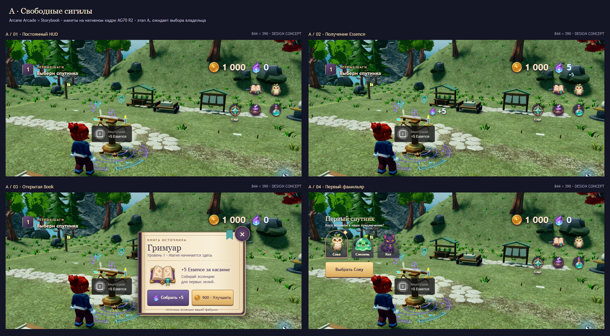
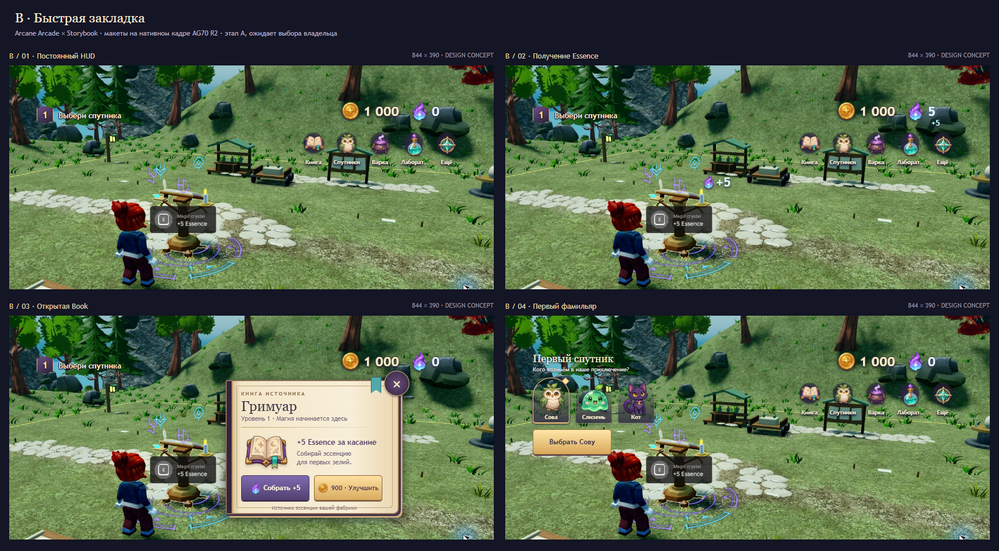

# AG-71 — Arcane Arcade × Arcane Storybook

**PHASE A DELIVERED / OWNER DESIGN GATE OPEN / PHASE B NOT STARTED.**
Issue [#44](https://github.com/branch-danya-dev/magicpotiongacha/issues/44).
No Roblox runtime files, gameplay, profile fields, remotes, prices or release
flags are changed. No asset uploads, permission changes, merge or publication.

Base: Draft PR #43 `c8b546bc1734cc435159cfa6b1122f9a23b806a5`, Windows/Ubuntu
[43596253360](https://github.com/branch-danya-dev/magicpotiongacha/actions/runs/43596253360) PASS.
Branch: `feat/ag71-ui-art-concepts`. Final HEAD/checks are recorded in the Draft PR.

## Choose a composition

The two options share the same illustrations, colors, type hierarchy, values
and native gameplay backdrop. They differ in navigation density and placement.

- **A — Свободные сигилы:** four independent icon buttons on the right in two
  rows; a labeled secondary-menu medallion. More open space; the four main
  actions rely on icon recognition and tooltips/long-press labels.
- **B — Быстрая закладка:** a short horizontal row with icon captions. Faster
  to learn and fewer ambiguous symbols; occupies more of the upper-right edge.
  Recommended for the first playable slice because this is a newcomer game.

[Editable HTML review](art/ag71/index.html) ·
[Artwork atlas](art/ag71/concept-atlas.png) ·
[Exact illustration prompt](art/ag71/imagegen-prompt.txt)

## Eight required frames

Every exported frame is **844 × 390**. These are design composites, not captures
of implemented Roblox GUI. `1 000 / 0`, book level 1, a confirmed +5 receipt and
900 Gold upgrade illustrate existing contracts; they are not new rewards or
measurements of a new session. The owl selection is a preview, not a grant.

| State | A | B | Intention |
| --- | --- | --- | --- |
| Persistent HUD | [PNG](art/ag71/A-hud.png) | [PNG](art/ag71/B-hud.png) | Goal left, icon+number currencies right, free center |
| Confirmed Essence | [PNG](art/ag71/A-receipt.png) | [PNG](art/ag71/B-receipt.png) | One +5 near the book and currency highlight, 0 → 5 |
| Book open | [PNG](art/ag71/A-book.png) | [PNG](art/ag71/B-book.png) | Illustrated grimoire page, collect/upgrade, visible close |
| Starter selection | [PNG](art/ag71/A-chooser.png) | [PNG](art/ag71/B-chooser.png) | Three portraits, selection outline, explicit confirmation |

The Book panel replaces the quick navigation while open; closing it restores
the five shortcuts. It does not hide CoreGui or movement controls. The starter
chooser replaces the short goal and stays above the movement reserve; it has
no empty screen-sized scrim. No other game window is redesigned here.

## Real backdrop and provenance

- Original ordinary Studio Play evidence:
  [day-reduced-near-AG70.jpg](evidence/ag70/r2/day-reduced-near-AG70.jpg),
  runtime `89804f0ea070b3b685a9939b00872fa0b5fe2b55`, Studio 0.747.0.7471481.
  [Original native receipt](evidence/ag70/r2/manifest.json).
- All eight concepts display that same image, with the same crop and scale.
  CSS crop: source x=500, y=470, width=1280, height=591.4691943; scale=844/1280.
  The original 2560×1392 file is unchanged. No inpainting, invented forest,
  replaced lighting, image filters, background repaint or geometry edits.
- The crop excludes the old AG64 HUD and Studio chrome. The native book prompt,
  avatar, ground and VFX remain in the image. CoreGui/touch controls lie outside
  this crop and are **reserved in layout, not fabricated or tested**. Optional
  `?guides=1` shows their reserved areas in the HTML review.
- This is retained R2 evidence, **not a fresh R3 screenshot**. R3 path/lighting
  changes are absent from this background. Phase A may use existing evidence;
  Phase B must verify the approved UI in fresh Play on the then-current base.
- The 12-illustration atlas was generated with the built-in image tool from the
  recorded original prompt. No third-party art was copied. All generated art
  is **concept-only**, not uploaded, moderated or admitted to Roblox. Hashes,
  exports and origin are in [manifest.json](art/ag71/manifest.json).

## Visual language

| Token | Value / use |
| --- | --- |
| Gold | `#FFDFA0` light, `#D9AC61` body, `#89613A` edge |
| Essence | lilac `#B69AE8` → cyan `#A5EEE8`; restrained glow |
| Ink | `#342E43`; violet leather `#34243D` |
| Page | ivory `#F8EFD9`, shadow `#D9C49D`; only in open Book |
| Foreground | `#FFF2C9` numbers, `#E2FAFF` Essence; dark edge/shadow |
| Numbers | 23–25 px, bold tabular-style sans, compact formatting at large values |
| Goal / controls | 12–14 px; captions 10–11 px, supplementary copy 9–11 px |
| Book heading | 24 px serif; short headings with roomy page margins |

HTML uses local Trebuchet/Arial and Georgia; no font file was downloaded or
embedded. Phase B should use compatible Roblox-provided fonts and recheck
Cyrillic glyphs/metrics. The generated atlas provides coin, Essence flame,
grimoire, owl, slime, cat, cauldron, flask, pouch, reward, cog and menu medallion.
No Unicode/emoji placeholders serve as final pictograms. Borders, text and
layout are editable native-style elements rather than baked into one screenshot.

## Layout, states and motion contract for Phase B

- The 844×390 concept reserves x<47/x>797 at the sides, y<58 for CoreGui,
  148×140 at bottom-left and bottom-right for movement/jump. These are design
  reservations, not a replacement for actual `CoreUISafeInsets`/notch queries.
- Visible targets are at least 44×44; nav 48×48 or 48×62, portraits 64×80,
  Book close 44×44. Numeric counters are passive, with no purchase '+' button.
- Check real 740×360, 844×390, 1024×768, 1366×768, 1920×1080 and narrow 19.5:9
  after approval. Anchor to safe edges, clamp scale, compact numbers, and
  collapse labels before losing 44px targets. Preserve inherited portrait/chat
  fallback. Tablet/desktop must not expand a small HUD into central cards.
- +N starts only after the existing owned-plot increasing server receipt;
  initial, rejected, replayed, foreign and capped receipts retain AG64 behavior.
  Use one reusable label, about 0.9–1.1s. Currency highlight ≤180ms; no new reward.
- Menu entrance ≤160ms, tiny page movement only. Reduce Motion: no travel,
  particles, scaling or page rotation; instant placement plus short opacity
  change. Quality tiers keep the same UI meaning; no effects layer dependency.
- Loading/pending/read-only/unaffordable/MAX states must follow existing
  snapshot projection. No optimistic balance change or local familiar grant.

## Existing actions retained

| Element | Existing source / destination |
| --- | --- |
| Gold / Essence | `state.gold`, `state.essence`, existing compact formatter |
| Level badge / goal | `state.stations.crystal.level`, `state.tutorial` (not a new XP system) |
| Book / collect / upgrade | `crystal`; existing `click` and `buy {upgradeId="crystal"}` validation |
| Familiars / starter confirm | `altar`; existing one-time starter choice and server confirmation |
| Brew / Lab | `cauldron` / `blueprint` |
| More → Shop / Rewards / Settings | `supplies` / `dailies` / `quality` |

Implement only the chosen HUD + Book + approved chooser adjustment inside the
existing `PotionTycoonUI/LandscapeHUD`. Other windows remain inherited and
reachable. Preserve the single state subscription and existing rollout/rollback;
decide an explicit Studio-only review switch before runtime changes. A full-frame
concept PNG must never become a ScreenGui backdrop. Any later sprite upload
requires separate approval for exact files/owner/Experience/permissions.

## Verification and gate

- Inspected both four-state boards and corrected chooser/Book overlaps.
- [HTML geometry audit](art/ag71/layout-audit.json): eight frames; all visible
  buttons ≥44px, inside the proposed safe area and outside touch reservations.
  This is **not** a native Roblox/device check.
- Re-export via `node docs/art/ag71/render.mjs`; set `AG71_CHROME` if Chrome is
  installed elsewhere. This uses an isolated headless browser profile under
  ignored build/, only local files, and never touches the user's browser profile.
- Inherited `npm run tools`, `npm test`, repeat-build and Windows/Ubuntu CI
  results are recorded at the exact final SHA in the Draft PR. They do not
  constitute acceptance of these designs.
- Fresh AG71 Studio Play, real phones/tablets, gamepad, live backend and 2–8
  clients: **NOT RUN — Phase B is gated**. Full V2 UI / AG60 remains open.

**STOP: owner must select A/B or request revisions. Approval of the overall
Arcade/Storybook direction is not approval of these concrete layouts.**
