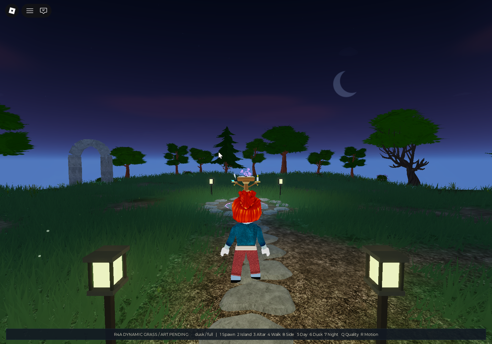
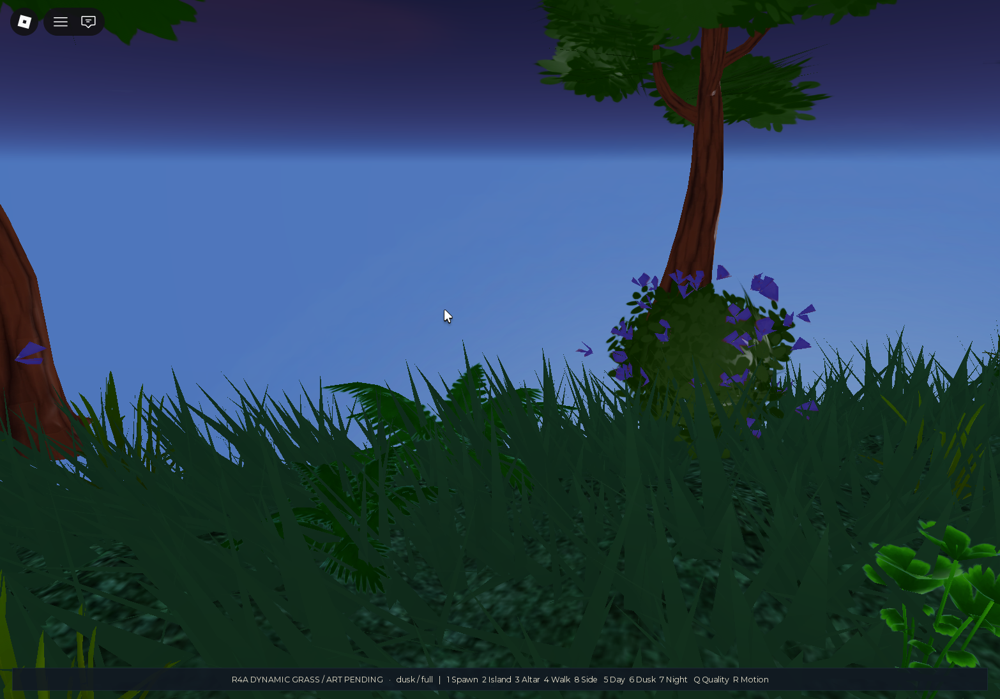
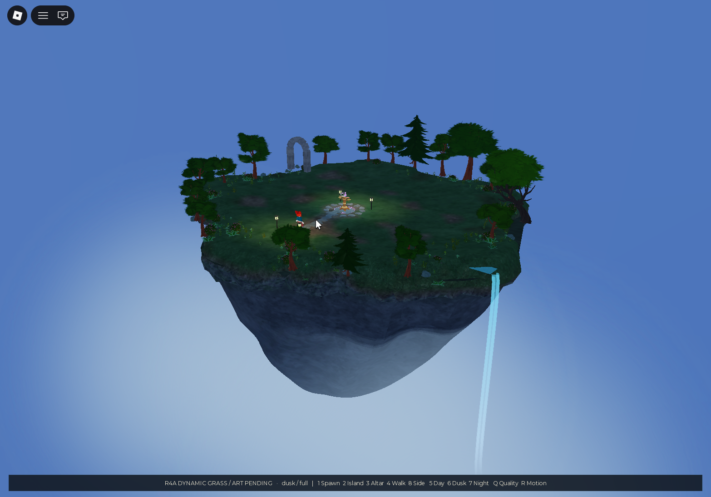
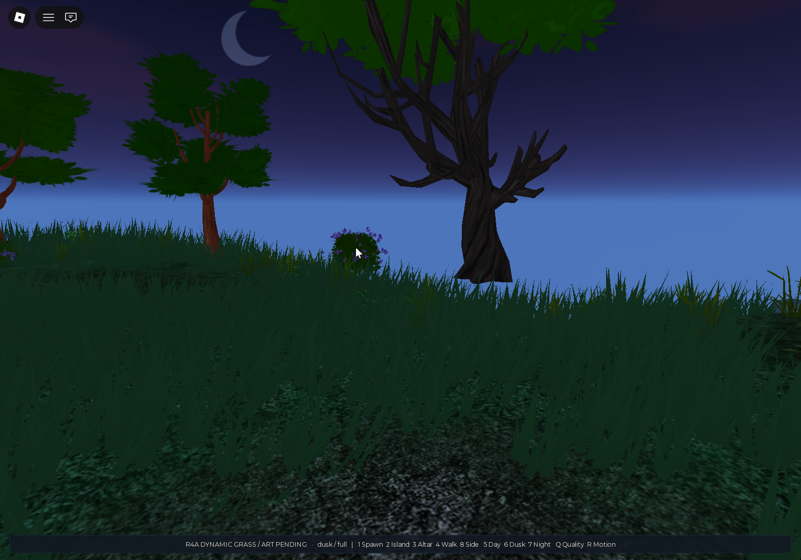
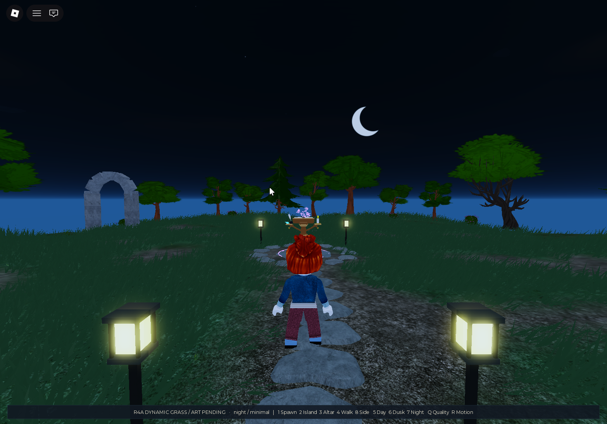
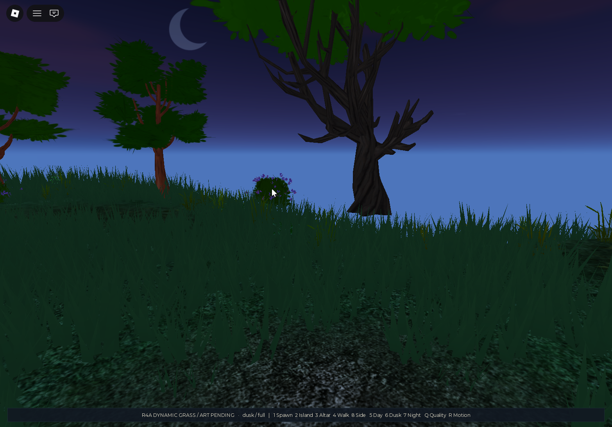

# AG-76B-R4A — Dynamic Grass & Ground Cover

**CODE CANDIDATE / STUDIO VERIFIED (bounded art QA) / OWNER ART PENDING / NOT INTEGRATED.**

Base: Draft PR #57, `d5f39fad50ac84e660365299f1b3c4de600e3a80`.
Branch: `feat/ag76b-r4a-dynamic-grass`. The final commit and exact-head CI are linked in the Draft PR. This is a separate Studio-only place; it does not run the production game bootstrap, persistence or economy.

## Implementation and protected scope

Native animated Terrain grass supplies the continuous cover. `Decoration=true` and `GrassLength=0.24` are serialized into the Rojo place. Length is a **global** Terrain setting, not a regional control. Regional variation combines native Grass, broad LeafyGrass/moss patches and different heights of admitted decorative plants. Existing stone/ground paths and rock materials are retained. Only Grass voxel materials change; the original occupancy array is written back unchanged.

The central clearing receives short clover and short grass; the perimeter and tree bases receive irregular tall grass and ferns. A seeded placement plan uses actual mesh radii, scale and sway margins, preserves all 13 station footprints and 26 worker endpoints, excludes the six-stud path/book/spawn clearances, and disallows tall cover in the future construction rectangle. Runtime raycasts seat plants on the actual Terrain surface; candidates without ground are skipped. The existing low grass/clover/ferns are also seated without changing X/Z: 67 supported plants adjusted, 9 unsupported rim plants removed. Trees, bushes and landmarks are untouched.

Muted emerald, olive and teal tints use existing `Grass_Wispy_Tall`, `Clover_2`, `Fern_1` and `Grass_Common_Short`. Source, license and hashes remain in the existing [woodland asset receipt](../assets/environment/woodland/receipt.json), with Roblox IDs in its pinned templates. No external model, texture upload, new permission or paid generation was used. Successful local preload does not close the inherited published-Experience permission gate.

The unchanged `EnvironmentView` remains the sole `Workspace.GlobalWind` owner. A QA-only style wrapper preserves the R3 atmosphere projection and replaces its wind sample with a smooth 12-second gust cycle. Existing MeadowMotion handles staggered nearby decorative motion within its existing 64/32/0 slots. There is no additional RenderStepped owner and no per-blade Lua animation. Reduce Motion sets wind and decorative motion to zero; native engine blade animation remains subject to Roblox behavior.

The builder verifies **every `src/` file**, `default.project.json`, all R2/R3 QA files and the approved v3 references against the exact base. No economy, V8, Config, Factory, DataStore, station, spawn, waypoint, tree, arch, waterfall, cloud or global-lighting implementation is edited. Island dimensions and collision occupancy remain unchanged.

## Budgets and actual counts

| Item | Result |
|---|---:|
| Deterministic candidate cap | 320 |
| Added MeshParts in final Play | 291 |
| Candidates skipped without Terrain | 29 |
| Added authored triangles | 112,530 |
| Clearing / tree bases / rim | 110 / 120 / 61 |
| Visible Full / Reduced / Minimal at spawn | 291 / 157 / 57 |
| Detail tiers 1 / 2 / 3 | 57 / 100 / 134 |
| Decorative motion slot caps | 64 / 32 / 0 |
| Decoration distance limits (studs) | 240 / 145 / 95 |
| Motion distance limit | 65 studs + screen culling |
| Changed Grass-material voxels | 122 |
| Changed occupancy voxels | 0 |
| New lights / particle emitters / connections | 0 / 0 / 0 |

Native Terrain blades are engine geometry, not counted as individual MeshParts or authored triangles. Their far-distance culling is engine controlled. The 291 meshes remain allocated at lower quality and are culled visually by the existing view. This is a bounded geometry increase over R3, not a claim of zero cost.

## Native Studio evidence

Windows Studio **0.747.0.7471481**, ordinary F5 Play, one reused window, viewport **1566×1095**, Studio viewport **Q6**; `SavedQualityLevel` reports **QualityLevel3** (recorded separately, not conflated with Q6). All originals below are native Studio Screenshot / F12 outputs, without image editing, generated pixels or external renders. The six captures and video were repeated after the final seating fix.

1. Spawn, dusk / Full: 
2. Character-height grass close-up: 
3. Whole island: 
4. Dense grass by trees: 
5. Settled night / Minimal: 
6. Full / Reduce Motion: 

[Original wind and gust video — 12.2 seconds](evidence/ag76r4a/grass-wind-gust.mp4), H.264, 1552×1088, approximately 30 FPS, encoded by RobloxGameEngine. Dusk / Full / motion enabled, grove camera, includes one full 12-second wind period. Still frames cannot establish motion quality; review the original clip.

[Evidence manifest](evidence/ag76r4a/manifest.json) pins the native filenames, camera conditions, SHA-256 hashes and tested place/source hashes. [Native observations](evidence/ag76r4a/studio-observations.log) contain only task-related outputs, not the full machine log.

## Validation and limits

`npm run tools`: PASS, pinned Luau 0.745 / Rojo 7.7.1. `npm test`: **1,372 Luau + 14 Node PASS**, 280 Luau sources compiled/analyzed, two inherited C01 warnings. Seven new tests cover deterministic/admitted/bounded planting, full station/waypoint extents, building and path clearances, material zones, quality tiers, smooth gusts and inherited motion caps including resets. Exact-head Windows/Ubuntu CI is recorded in the Draft PR.

Final native asset preload succeeds with no failed assets. Twenty quality switches leave 873 descendants in the cover folder before/after (291 models, meshes and material appearances). Reduce Motion verifies zero global wind, zero reported decorative/general motion, and unchanged CFrames for all 291 added MeshParts over two seconds. All seven points of the Humanoid MoveTo route are reached with normal physics and health 100, minimum root Y 3.7094, including the book approach, central clearing, cauldron2 and return to spawn; no teleports.

Performance samples are **RenderStepped frame intervals**, not separate CPU/GPU render timings. Before/after runs use the same window, viewport, graphics setting, dusk spawn camera and 15-second samples after three seconds settling per quality. The baseline is an actual fresh R3 Play from the exact base. Exact samples are in [metrics.json](evidence/ag76r4a/metrics.json).

| Quality | R3 FPS | R4A FPS | R3 p95 ms | R4A p95 ms | Studio MiB before / after |
|---|---:|---:|---:|---:|---:|
| Full | 238.12 | 232.47 | 5.155 | 5.666 | 2892.50 / 3092.21 |
| Reduced | 238.30 | 233.65 | 5.167 | 5.538 | 2892.96 / 3090.07 |
| Minimal | 237.38 | 239.74 | 5.131 | 5.104 | 2896.06 / 3090.23 |

Full/Reduced p95 rose by approximately 0.51/0.37 ms in this single matched run. Near-240-FPS-cap samples cannot establish mobile headroom or a statistically reliable improvement in Minimal. Studio total memory includes cached documents/assets across reopened scenes and cannot isolate the grass allocation. No test suite, video recording or screenshot was running during these measurement windows.

Open gates: owner art approval; real phones, GPU profiler and mobile thermal/memory behavior; full production gameplay/multiplayer integration. This QA scene preserves station markers and coordinates but does **not** test the production cycle. No live DataStore, purchases, policy or publication test was performed. R3 temporary trees/arch, tree placement/silhouettes and the simple ribbon waterfall remain inherited art limitations outside this grass pass. The grove view still exposes the temporary tree base against the horizon; it was deliberately not redesigned here.

## Reproduce and review

```text
npm run tools
npm test
node scripts/build-grass-island.mjs
```

Open `build/WizardIsland-AG76B-R4A-Grass-ART-PENDING.rbxlx`, then F5. Build SHA-256: `939602a1903960a667ab9fe3f4afc9fdd8e0638f8efe01c774fb66fc98f0f36c`.

Keys: 1 spawn, 2 overview, 3 altar, 4 normal player camera/walk, 8 side; 5 day, 6 dusk, 7 night; Q quality, R Reduce Motion. Additional reproducible camera names `grass` and `grove` are available through the local Studio-only `WizardReviewControl:Invoke("camera", name)`. Default is dusk / Full with motion enabled. CI attaches the separate R4A place and build receipt.

Terrain reference: [Roblox terrain](https://create.roblox.com/docs/parts/terrain), [Terrain API](https://create.roblox.com/docs/reference/engine/classes/Terrain), [global wind](https://create.roblox.com/docs/environment/global-wind).

Stop for the owner's visual gate. No integration, merge, Roblox publication or final art acceptance.
