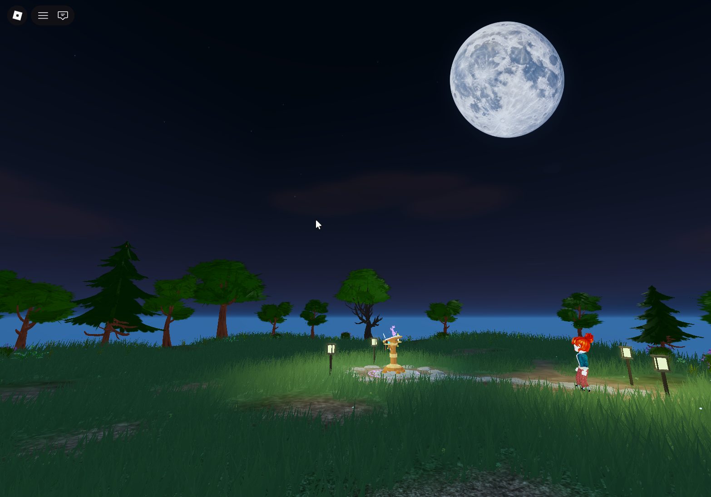
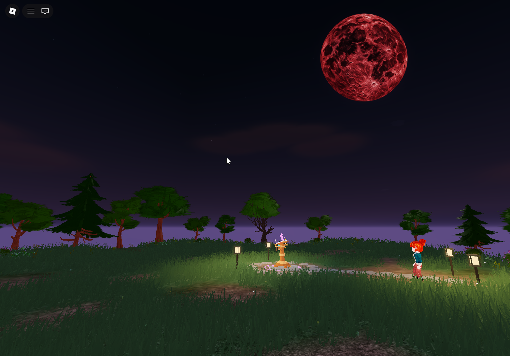
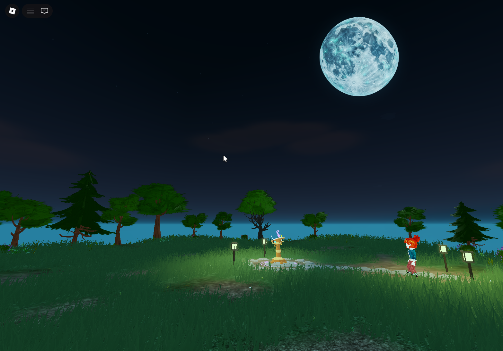

# AG-76B-R4B — Three Moons & Lunar Lighting

**CODE CANDIDATE / STUDIO VERIFIED (bounded QA) / OWNER MOON ART PENDING / NOT INTEGRATED.**

Draft [PR #59](https://github.com/branch-danya-dev/magicpotiongacha/pull/59), stacked
on Draft PR #58, `56666c072e66f7357ec2f054f818a642cae0abd9`.
Branch: `feat/ag76b-r4b-moon-cycle`. Native verification details below are bounded
to the isolated QA place, not the production game or backend.

## Reproduction and scope

Run `npm run tools`, `npm test`, then `node scripts/build-lunar-island.mjs`.
Open `build/WizardIsland-AG76B-R4B-Moons-ART-PENDING.rbxlx` and press F5.
The receipt `build/lunar-island-build.json` records the checkout HEAD, artifact
SHA-256 and protected paths. Rebuilding does not require Roblox uploads.

QA keys: `Z/X/C` Pearl/Blood/Frost, `0` automatic selection, `9` matched moon
camera, `5/6/7` day/dusk/night, `T` dawn, `Q` quality, `R` Reduce Motion,
`1/2/3/8` spawn/overview/altar/side cameras, `4` ordinary character control,
`H` hide footer. Eight-second transitions are intentional. These controls are
absent from the production build.

The builder first reproduces R4A, then composes QA aliases and a generated copy
of the existing EnvironmentView. All inherited `src/`, existing assets,
R2/R3/R4A geometry/grass scripts and `default.project.json` are checked against
the base commit. No station, waypoint, gameplay, economy, V8, remotes, flags or
save behavior changes. The ordinary production build remains separate.

## Lunar behavior

| Period | Seconds | Phase | Clock endpoints |
|---|---:|---|---|
| Day | 300 | 0–0.2 | 08:30–17:30 |
| Dusk | 375 | 0.2–0.45 | 17:30–20:30 |
| Night | 675 | 0.45–0.9 | 20:30–05:00 |
| Dawn | 150 | 0.9–1 | 05:00–08:30 |

A deterministic integer hash of `floor(GetServerTimeNow()/1500)` selects Pearl
70%, Blood 10%, Frost 20%. It is presentation only, with no random rewards or
messages. The state changes during invisible daytime; Studio manual selection
crossfades a fixed three-image set over eight seconds, including interrupted
crossfades. Weather keeps the inherited schedule and independently attenuates
the lunar palette and disk. Sun/moon clock interpolation is monotonic.

| Palette | Ambient target RGB | Outdoor target RGB | Intent |
|---|---|---|---|
| Pearl | 143,162,194 | 162,181,209 | Silver-blue, calm |
| Blood | 162,145,171 | 181,161,185 | Restrained rose-burgundy haze |
| Frost | 131,170,185 | 153,190,206 | Cool turquoise-silver |

These are weighted nighttime targets, not an unconditional global color wash.
Warm lantern colors remain inherited. The same EnvironmentView applies all
Lighting, Atmosphere, postprocessing and GlobalWind values. A scene-folder
guard additionally rejects duplicate starts from Studio's separate module
contexts before any lighting mutation. No additional render connection or
light is introduced.

The BillboardGui position follows `Lighting:GetMoonDirection()` at the existing
celestial distance. The native moon remains disabled. The nominal billboard is
2.5× R4A; visible disk is approximately 2.1× after transparent padding.

## Texture origin and bounded delivery

`assets/environment/lunar/manifest.json` pins all three owner-provided Library
originals to the requested SHA-256 values, the generated transparent edits,
their prompts and the final deterministic 512×512 reductions. No Elden Ring
or other franchise asset is used. No third-party CC0 license is implied.

Local Studio Play uses three fixed 512×512 EditableImages plus one 64×64 radial
halo: **4 images / 4 labels / 3,162,112 RGBA bytes**. Images are decoded once;
there is no texture churn. Full halo strength is 0.16, Reduced 0.08, Minimal 0.
The moon survives Minimal and Reduce Motion. Allocation failure cleans partial
resources and falls back to the previously permitted moon; allocation success
was tested in native Play. Failure injection on a physical low-memory device
was not performed.

Roblox asset IDs are intentionally absent. No asset upload, account permission
change, paid provider job, merge, publication or production integration occurred.
This local EditableImage path is **not** production asset admission.

Official API references: [EditableImage](https://create.roblox.com/docs/reference/engine/classes/EditableImage),
[EncodingService](https://create.roblox.com/docs/reference/engine/classes/EncodingService),
[GetMoonDirection](https://create.roblox.com/docs/reference/engine/classes/Lighting/GetMoonDirection).

## Native Play images

The following PNGs are original Roblox screenshot-command outputs, copied
byte-for-byte. No rendering, compositing, retouching or generative processing
was applied to the screenshots. Source texture preparation is separate.

All three nighttime variants use the same camera: relative position
`(-43,8,14)`, target `(0,19,-8)`, FOV 78, clock 20.5, cloud 0.08, Full.
Viewport is 1566×1095. The Studio toolbar was Q6; stored user quality was 3.

| Capture | Native image |
|---|---|
| Pearl / Full | [01](evidence/ag76r4b/01-pearl-night-full.png) |
| Blood / Full | [02](evidence/ag76r4b/02-blood-night-full.png) |
| Frost / Full | [03](evidence/ag76r4b/03-frost-night-full.png) |
| Pearl / Reduced | [04](evidence/ag76r4b/04-pearl-night-reduced.png) |
| Pearl / Minimal | [05](evidence/ag76r4b/05-pearl-night-minimal.png) |
| Pearl / Reduce Motion | [06](evidence/ag76r4b/06-pearl-reduce-motion.png) |
| Dusk, moon near horizon | [07](evidence/ag76r4b/07-pearl-dusk.png) |
| Dawn, moon hidden, opposite camera | [08](evidence/ag76r4b/08-dawn-moon-hidden.png) |

The eight gallery images were captured from runtime source
`d13cf308b68f00a559b15f7bd1352e2c48c58d20`, artifact SHA-256
`18160bde15fece507af5bc7705293382e2546b751c4e585bc348c062eadb649b`.
The subsequent `c682e739027da96b37bffec0fa7c0ecc451f0e26` change only adds the
duplicate-owner guard and its QA test/control; it does not change appearance.
The corrected artifact was reopened in the same Studio window and retested.
Final runtime artifact SHA-256:
`9c849264e9e7f22660dfde5ef182796515351d026de25742b90f135bf7d62566`.

## Checks and remaining gates

Automated: 1,386 Luau tests and 17 Node tests, including 14 new lunar semantic
tests and 3 new pixel/ownership tests. Compile, portable analysis, protected
source comparisons and Rojo build are included. Exact final CI/build receipt
and native measurements are recorded in the evidence files and PR.

Native repeated-switch test: 20 quality/moon/motion switches; weather-folder
descendants before/peak/after **279/279/279**. Four EditableImages and four labels
remain bounded. Duplicate starts are rejected in both the LocalScript context
and the separate Command Bar context. Reduce Motion gives GlobalWind `(0,0,0)`
and zero moving meadow entries. Moon direction alignment is **1.0**.

The existing 45-second compressed preview ran for 53.045 seconds / 1,004
samples, spanning a complete cycle and weather pass. Moon alpha ranged 0–0.95;
up to 60 rain elements appeared. Maximum observed Ambient channel change per
approximately 0.05-second sample was 0.02383. This is sampled transition
diagnostics, not a guarantee about every rendered frame or a full 25-minute run.
Stop restoration passed with no failures: all 12 Lighting properties, original
wind, original Lighting/Terrain child identities and no surviving weather folder.
The same window was restarted into clean F5 Play for owner review.

## Preliminary desktop performance

15-second RenderStepped samples; same spawn camera/FOV 82, clock 0, viewport
1566×1095, same Studio process. Raw results including the excluded passes are
in [native-checks.json](evidence/ag76r4b/native-checks.json).

| Quality | R4A FPS | R4B FPS | R4A p95 ms | R4B p95 ms | R4A / R4B total Studio MiB |
|---|---:|---:|---:|---:|---:|
| Full | 209.37 | 231.63 | 6.38 | 5.62 | 1574.42 / 2898.23 |
| Reduced | 210.67 | 239.44 | 6.29 | 5.15 | 1577.63 / 2897.24 |
| Minimal | 231.35 | 239.62 | 5.48 | 5.07 | 1579.04 / 2897.21 |

These are **not a controlled performance acceptance** or proof of a speedup.
R4A's sample overlapped command-line checks, whereas R4B's did not. R4A uses its
old art-directed moon position and R4B the real moon direction, so matching the
camera/clock does not make identical sky coverage. Studio retained assets from
several place loads and Play sessions. GPU timestamps and fresh-process memory
deltas were not measured. Separate initial R4B Reduced/Minimal samples at clock
20.5 yielded 105.86/60.00 FPS; they are retained in the raw record but excluded
from the clock-0 comparison. The variation reinforces the need for controlled
device measurements before setting a performance budget or claiming a regression.

Limitations / open checks:

- Owner moon art review is pending; R4A grass approval does not approve the R3 composition.
- Real smartphones, multiplayer synchronization in live clients, DataStore and
  production services are **NOT TESTED**. Deterministic synchronization has
  portable tests, not a claimed multi-client acceptance.
- Alpha tests permit at most 1/255 residual alpha in Pearl/Blood padding from
  the image editor; Frost padding is zero. No visible square/fringe was seen
  at the captured Play size, but mathematical zero-alpha perfection is not claimed.
- RenderStepped intervals are desktop frame intervals, not isolated GPU timings.
  Total Studio memory includes cached scenes/assets and editor state across
  repeated Play sessions; it cannot establish the lunar feature's heap cost.
- Native logs also include unrelated editor telemetry timeouts, a local Rojo
  connection refusal and an unpublished-place universe-0 lookup. Required scene
  assets reported no failed preload; the QA scene renders without a live Rojo server.

Wait for owner moon review before any integration or further art acceptance.
