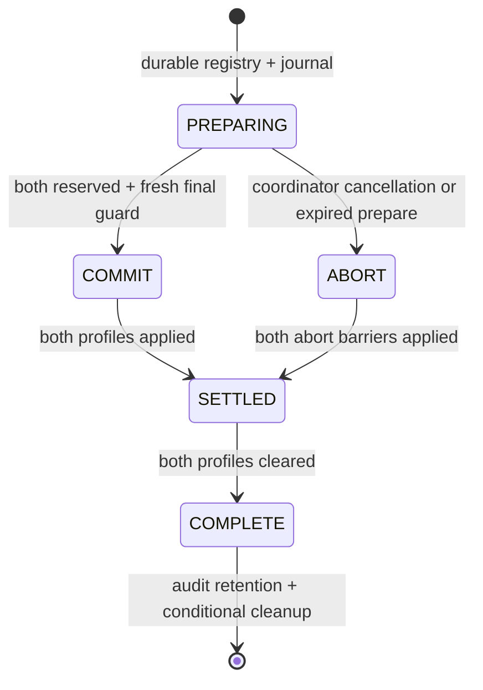

# Architecture — M4

## Boundaries

| Layer | Responsibility | Authority |
| --- | --- | --- |
| `src/shared/Config.luau` | Recipes, costs, storage limits, station caps, fixed hires | Server reads canonical values |
| `src/shared/Factory.luau` | Profile schema, commands, production and catch-up | Pure deterministic state transitions |
| `src/shared/Progression.luau` | Phase/slot prerequisites, rare-cauldron equipment and durable progression receipt | Pure candidate transitions; server commits |
| `src/shared/LegacyConfig.luau` | Frozen pre-M3 schema vocabulary/ranges | Historical V1/V2/V3 validation only |
| `src/shared/Familiars.luau` | Species/range validation, exact outcome disclosure, evolution preview | Pure canonical model |
| `src/shared/Collection.luau` | Summon/fixed purchase/lock/Fuse candidate and operation receipt | Server supplies policy, clock, preview and RNG |
| `src/shared/Policy.luau` | Bounded permission cache, fail-closed access, late-result fencing | Server injects PolicyService lookup |
| `src/shared/Protocol.luau` | Exact request shapes and per-player token buckets | Server only |
| `src/shared/Access.luau` | Intent target and finite range checks, called with server-owned identity/position | Server only |
| `src/server/ProfileStore.luau` | Session lease, validation, snapshot writes, retry fencing | One persistent player key |
| `src/shared/TradeCodec.luau` / `Trading.luau` | Canonical snapshots/SHA-256, validated reserve/apply/clear transitions | Pure model; trusted server coordinator only |
| `src/shared/TradeSession.luau` | Same-server invitations, exact offer review, both-party consent and post-yield checks | RAM negotiation never transfers ownership |
| `src/server/TradeJournal.luau` / `TradeCoordinator.luau` | Bounded persistent registry, irreversible decision, two-profile recovery | Journal CAS plus normal profile leases/revisions |
| `src/server/TradeRuntime.luau` | Player identity, Bazaar proximity, forced policy, admission switch, recovery worker | Roblox server adapter |
| `src/server/Main.server.luau` | Player lifecycle, ownership/distance checks, simulation and save scheduling | Server |
| `src/server/World.luau` | Greybox plots, pads, prompts, public visual attributes | Server presentation |
| `src/client/` | Adaptive controls, notifications, cosmetic familiar proxies | No rewards or economic writes |

Pure modules are shared source, not shared authority. Knowing a recipe or a price does not allow a client to decide the result.

## State and time

The profile stores `lastSimulatedAt`, balances, station jobs and buffers, cargo in transit, familiar instance IDs and base stats, ingredient/quest stock, active order, deterministic PRNG state and deployed-slime timers. It has a versioned schema. Recipes, persistent purchase/receipt fields and rebirth count are present for later expansion, but later features are not enabled.

One simulated tick is one integer second. Both online updates and join catch-up run this same function. Offline work is capped at 7200 seconds; the skipped tail is consumed by advancing the saved timestamp, not banked for a second login. Offline catch-up is durably saved before the player can interact or see its rewards. The welcome report is informational, not a reward-grant request.

At batch start, machine inputs and the machine's own Essence tank are consumed once. The crystal reservoir cannot power a batch directly. Manual `load` transfers missing ingredients and one recipe's Essence. Purchased pipes rotate first priority and transfer up to the configured rate per built machine each second, plus liquids through the intermediate store. Jobs contain their recipe, automatic/manual origin and effective timing; completing a job cannot charge the same batch again. Automatic jobs pause without a master. Manual jobs can finish without a worker.

Hauling removes cargo from its source into a persisted in-transit record, then delivers only what fits. Unassigning a carrier pauses its cargo rather than deleting it. New routes use solids and quest crates only; legacy liquid cargo may finish once. The fixed route duration is work to perform; each tick advances by `1 + capped Hauling * haulSpeedPerSkill`. Replacement workers use their current capped skill. Cargo already picked up is not resized to the replacement's capacity. Routes rotate among warehouse-to-input, source-to-warehouse and machine-queue-to-quest-stock to avoid starvation.

Full buffers block their own operation. Raw, intermediate, machine crate queues and delivered quest stock have separate capacities. Regular potion output bypasses storage and is sold immediately. A contract's quota counts **queued + travelling + delivered**. Before completing a batch, room for the maximum possible matching output is checked; waiting neither spends again nor rerolls the saved RNG. Excess above the quota exports. Expiry exports all three completed-crate locations once and clears only the affected cargo. An unfinished batch completes normally later. Claim checks delivered stock only and clears the active order before any second claim can succeed.

The V2 profile also stores `pipeCursor`, per-machine `essence`/`questQueue`, tutorial facts, first-event timestamps and bounded per-station stall seconds. These use the same integer-second simulation online/offline. Telemetry is local profile diagnostics, not external analytics. First events cover manual brew, automatic brew, upgrade, contract claim and tutorial completion; there is no user-supplied event endpoint or tutorial reward endpoint.

The saved PRNG is used only for prototype production events (slime and double output). Gacha uses an independent server `Random.new()` instance; neither its seed nor the production `rngState` is sent to the client.

V3 adds instance rarity/evolution/lock/provenance, `currencyPaid`, and a bounded last collection receipt. Old V1/V2 pets keep their IDs/stats/assignments and receive explicit `Legacy` metadata. See [PERSISTENCE.md](PERSISTENCE.md) for migration and recovery. No collection action occurs during offline simulation; evolved slime species retain the existing deployed-slime production behavior.

V4 adds phase, seven unbuilt slots, a separate progression receipt, rare-cauldron
instances/serial and per-material `inputCursors`. Config separates permanent slot
ID from archetype; recipe compatibility uses archetype, while jobs, workers,
queues and delivery destinations always use the actual slot ID. Local coordinates
and input/output waypoints never participate in accounting. Build pads are fixed,
explicit prompts; replacement phase frames are non-colliding presentation.

The original seven route indices stay stable. Appended routes and a cached target
per material keep solid routing O(slots × item types). Liquid input delivery visits
each material/slot pair once, beginning at its saved turn. A one-unit stream cannot
always favor the same consumer. `prioritize` changes the next delivery turn only.
From phase 3 each material's new intake is capped at floor(category capacity /
configured material types); existing over-target stock remains usable, and cargo
already picked up respects global space rather than a newly activated share cap.
Neither rule adds a separate offline scheduler.

## Command flow

1. Protocol validates the exact payload and consumes request budgets.
2. Main requires the sender's active, writable session and proximity to their own target station.
3. Factory advances server time, validates state, and applies an intent using canonical configuration.
4. Main sends an explicit public snapshot, including production codes/shortages/progress, storage capacities, tutorial target and queued/travelling/delivered order totals. PRNG state, receipt history, diagnostic history and leases are omitted.
5. Periodic saves persist immutable snapshots. Player departure freezes actions before final saving.

The client never supplies a reward amount, price, drop, owner identity, clock, completion time or generated pet stats. `discard` is an explicit, confirmed ingredient-management action, not a general inventory deletion endpoint.

Public construction uses `build(expectedLevel, requestId)` (0/1 level for pipes).
`advancePhase` includes expectedPhase/requestId. World pads and UI supply observed
server state, never prices or grants. Stale requests cannot buy the next level.
Legacy pure Factory `buy` is an internal primitive used by Progression and retained
regressions; Main explicitly rejects that remote action. Ownership, range, active
Player identity, Protocol budget and writable lease remain mandatory. Unknown
commit outcomes fence the session before presentation.

Tutorial records facts when actions/production actually occur, including actions out of order. It grants no resources. Free harvest, click and manual refill remain available; recipe changes, missing assignments and excess raw stock have explicit recovery controls. The menu starts closed, uses 44-pixel action buttons, horizontal station navigation and orientation-dependent bounds reserving the lower screen. Server attributes place cosmetic crates at a queue or saved route position; visual movement never triggers delivery. Engine/device usability remains a manual gate.

## Durable collection and progression commands

Summon, fixed shop, legacy hire, lock and Fuse pass Protocol, own-object distance,
active Player identity and lease checks. The runtime freezes factory actions/ticks
while a command is pending. A random command obtains a server PolicyService result
(60-second cache, 4-second lookup timeout); only explicit unexpired unrestricted
permission passes. Both identity and distance are rechecked after lookup and after
waiting for the profile gate. Guaranteed operations do not depend on this lookup.

`ProfileStore:transact` clones the latest profile under its existing per-key gate.
The pure command checks capacity/funds/parents before mutating the candidate; the
server draws outside the retrying DataStore callback. The candidate, payment,
parents/output, serial and operation receipt are saved together under the same
lease/revision. Only a confirmed write replaces live memory and produces a success
notice. Unknown write outcomes freeze the session for reconciliation by a fresh
lease/load; autosave cannot restore the older live snapshot over a reward.

Build, phase, equip and cauldron-lock use this same gate and candidate transaction.
They have an independent monotonic `progression.sequence`, but share the runtime
pending guard with M2; concurrent shop/construction cannot overwrite each other.
Entering phase 3 debits Gold and creates its unique milestone item in that same
candidate. Equip checks ownership, compatible built slot, unique installation and
absence of a prepaid job. Bonus is snapshotted into the next job under the normal
production cap. Neither cauldron lock nor a platform trading permission activates
trading. Guaranteed progression does not call the random-policy lookup.

Client `requestId` must be the saved sequence + 1. Repeating the latest identical
canonical intent returns its durable receipt without saving/drawing again; older
IDs and conflicting intents fail. A one-second collection cooldown supplements the
shared Protocol token buckets and per-session pending guard. Fuse requires five
exact IDs, a 60-second server preview token and explicit confirmation; parents,
stats, assignments, lock state and paid ancestry are revalidated at commit.

Inventory snapshots contain at most 128 instances. The client renders six text
cards per page, search/sort/free-worker controls, base/effective stats and known
shop outcomes. Only deployed workplace proxies animate. Viewing the Details panel
is required by the standard summon UI before its explicit spend confirmation;
the server still enforces restrictions against forged UI/remotes. Displayed
probabilities are derived from the same Config as the sampler.

## Lifecycle and failure handling

A local session is bound to the actual Player instance, not just its numeric ID. A second arrival cannot replace a still-loading/closing session. Cleanup verifies owner identity before touching the plot. Shutdown considers pending joins and releases within Roblox's shutdown time budget.

An unexpected simulation failure invalidates the profile before disconnecting the player. Quarantined memory is never written; the last valid save remains authoritative. A previous immutable snapshot already in flight may finish, but it cannot reopen the quarantined session. See PERSISTENCE.md for the storage adapter's limits.

## Durable two-profile exchange — M4

The [ADR](M4_TRADING.md) defines the protocol and its limits. Negotiation follows
invited → negotiating → both_ready → frozen/recovering → settled/aborted. Offer
edits reset both users' readiness and explicit confirmations; the server validates
the full canonical snapshot as well as the SHA-256/version review label.

V5 adds trade sequence, bounded receipt and optional durable pending marker.
Prepare freezes the whole profile. Main blocks ordinary actions/ticks; pure
Factory/Collection/Progression and ordinary ProfileStore transactions also reject
pending state. Pending recovery occurs before login catch-up or public inventory.
Normal saves can renew/release an unchanged reservation but cannot erase it.
`transactTrade` is a trusted internal adapter port, never a client-supplied transform.
Lease time is checked again inside every UpdateAsync callback after any queue delay.

After COMMIT, apply/clear are idempotent and cannot roll back. Journal snapshots
retain the transfer data until both profiles are applied and cleared; only then
are they compacted. An ABORT fences even a never-prepared side against late work.
Original IDs/stats/ancestry remain; only rare-cauldron ownerId changes. Incoming
capacity is checked net of outgoing objects. Strong items still use station caps.

The permanent 16×128 registry bounds retained journals and enables background
recovery without player activity. Normal profile leases protect absent players
from competing live writers. A full shard stops admission, never evicts pending
ownership data. Recovery persists when admission is disabled. All operations have
bounded retries; live platform latency, hot-key throughput and failure acceptance
remain BLOCKED. TradingEnabled is false by default; explicit activation additionally
requires Studio or the allowlisted private QA place. Rebirth and Robux purchase
handlers remain deferred.
