# Gate A.2 — actual Studio review evidence

**ART PENDING / NOT APPROVED. Low-quality stippling OPEN.**
The muted sunset horizon still needs art review; warm directional light alone is
not approval of the requested pink/amber sky. No #18 UI or #19 island work.

Captured 2026-11-05 in Roblox Studio 0.745.462.7451125, Future lighting.
Images are unmodified 2560×1392 window captures. [Manifest](captures.json) records
exact build/image SHA-256 and normalized final source hashes. Capture-time source
was an uncommitted patch over `f343966580e91b20db4f1516741bae1d0e8ee291`;
the manifest, rather than an invented commit SHA, identifies that patch.

## Same-camera five-state review

Manual graphics 10, environment Full; overview camera at `(-175,39,-7)` looking
at `(-145,9,-83)`, FOV 53. Beauty harness hides gameplay annotations. It does not
pass gameplay/UI acceptance. [Settings proof](after-settings-high10.jpg).

| Day | Sunset |
| --- | --- |
| 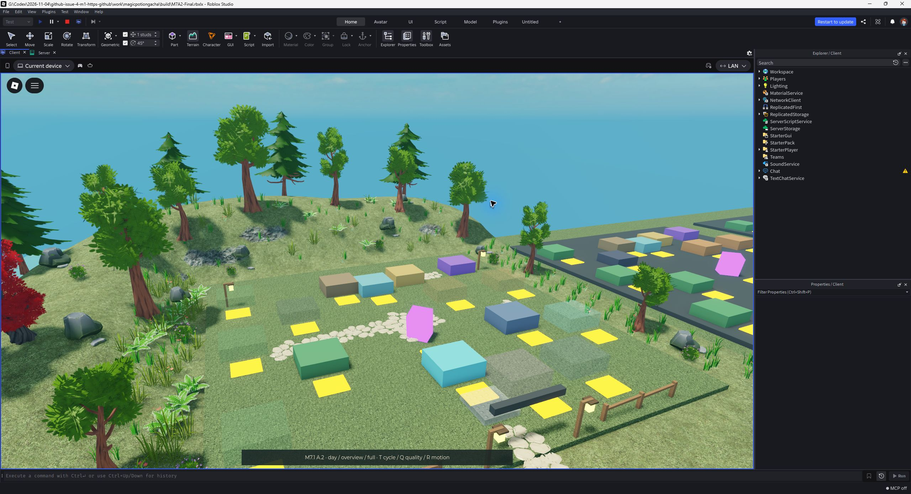 | 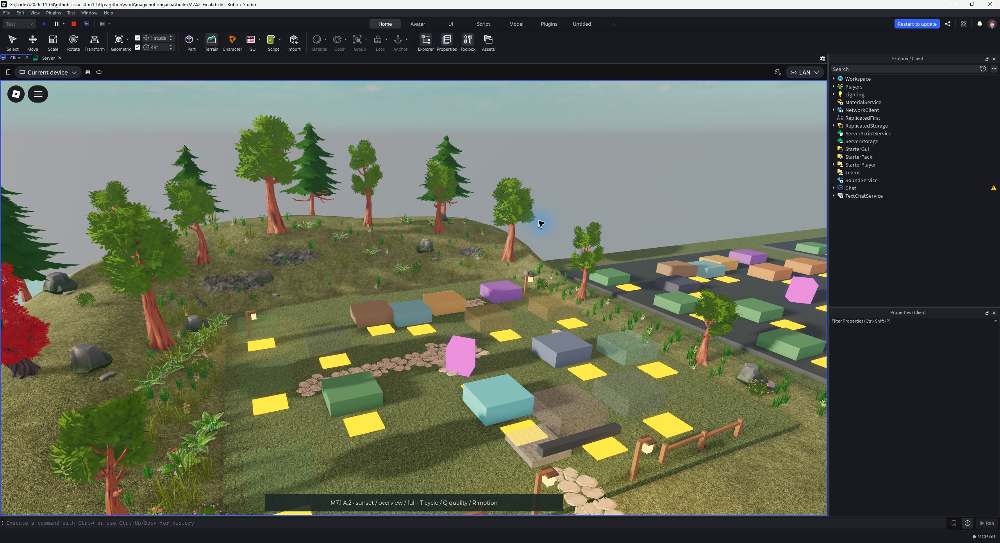 |
| Night | Rain |
| 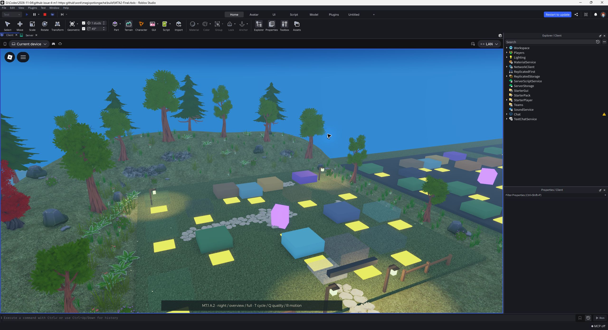 | 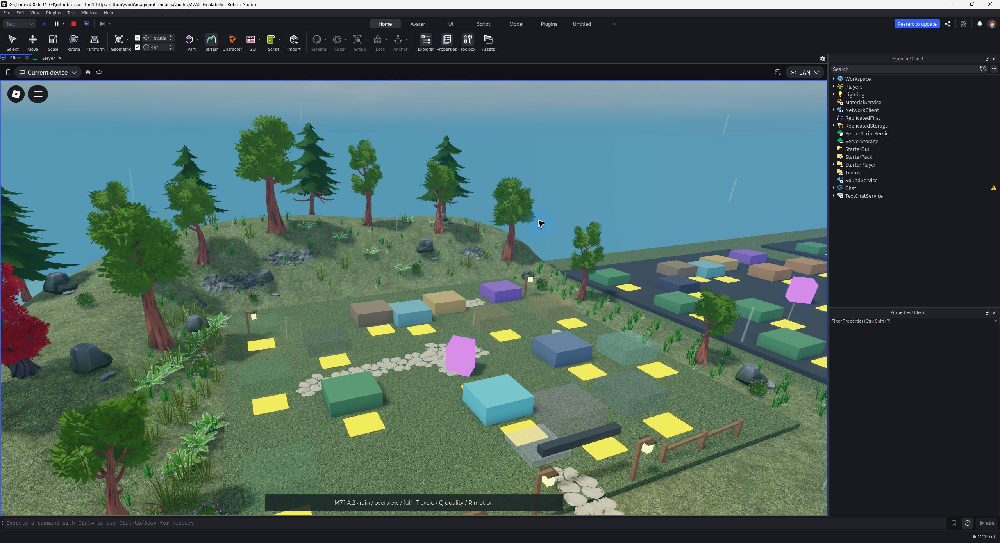 |

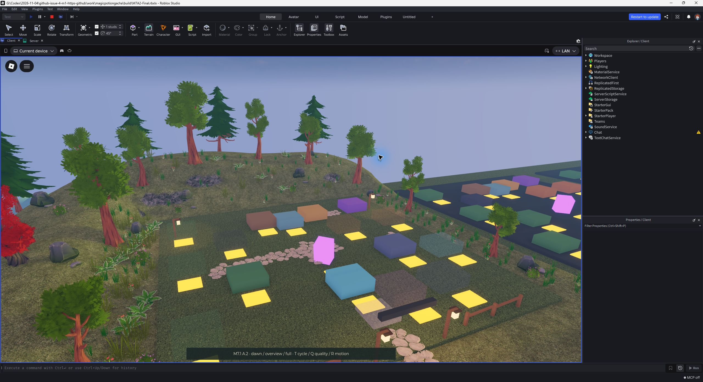

## Automatic and low quality: same overview, before/after

Before = clean A.1 baseline. After = clean final A.2 build. Effect preset Full in
both. Automatic is adaptive and must not be treated as a fixed internal level.
Manual 5 is the controlled low-quality setting. Grain/marks remain visible on
some distant stones and leaf cards; high quality is not a repair.

| Setting/state | A.1 before | A.2 after |
| --- | --- | --- |
| Automatic, day | 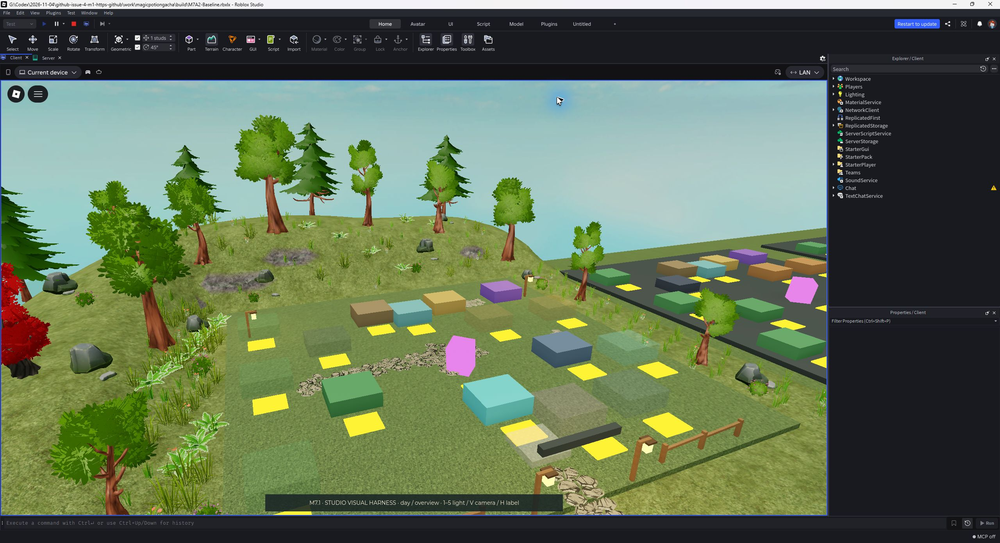 | 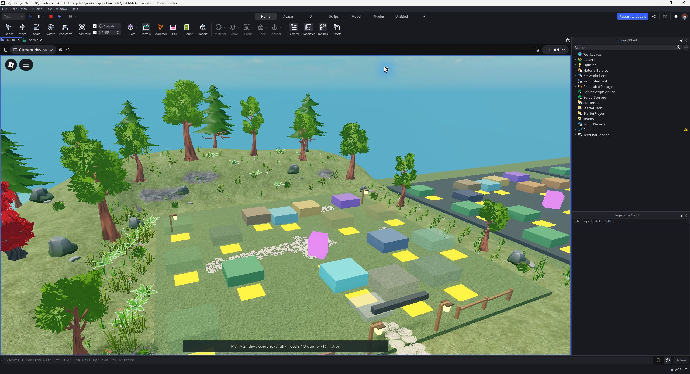 |
| Automatic, night | 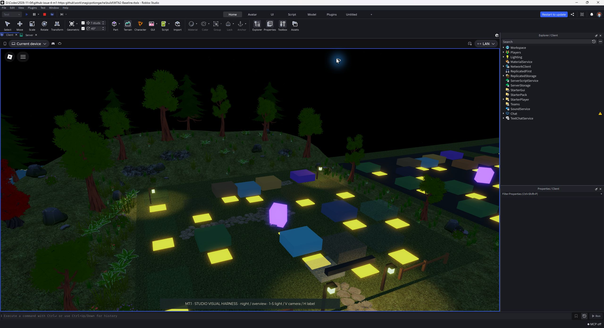 | 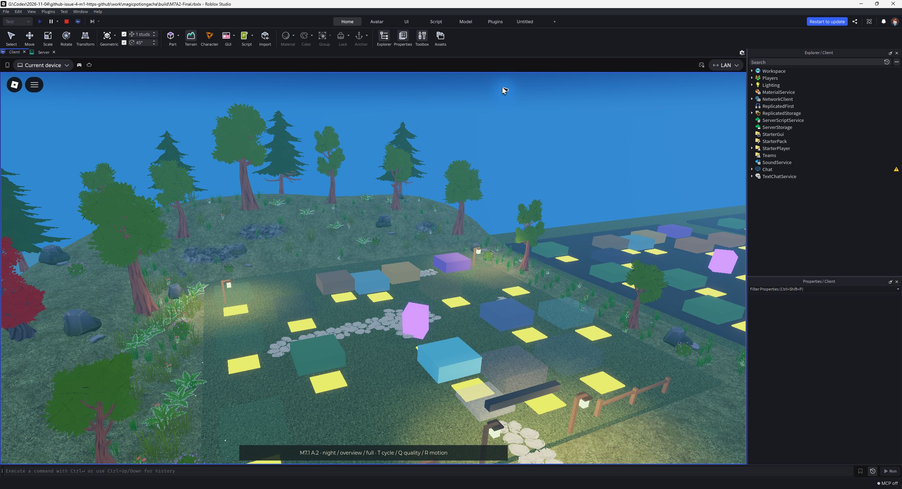 |
| Manual 5, day | 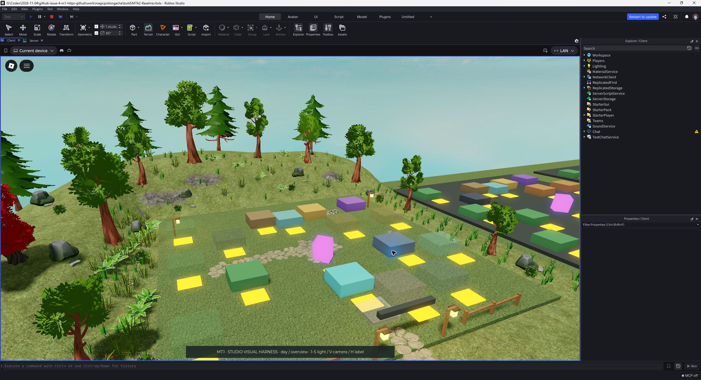 | 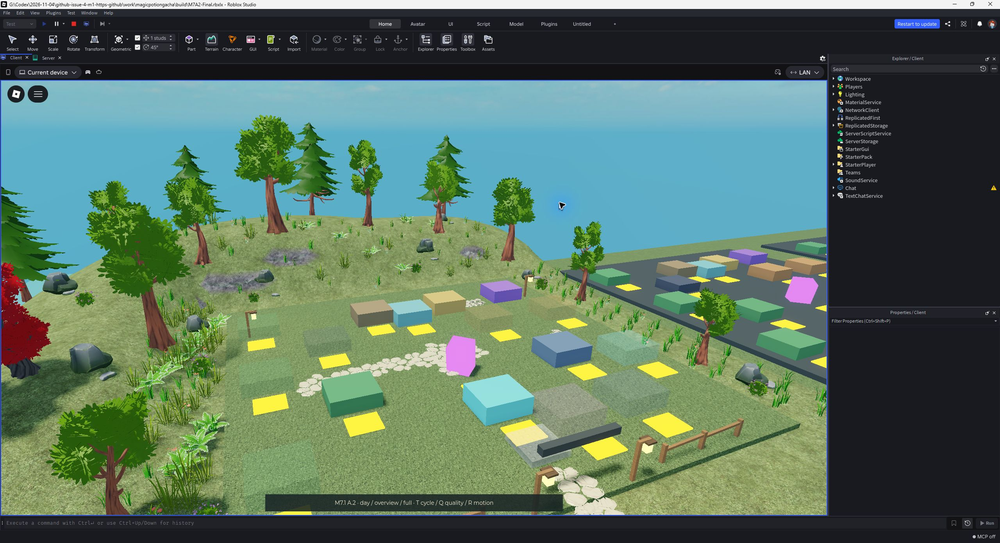 |
| Manual 5, night | 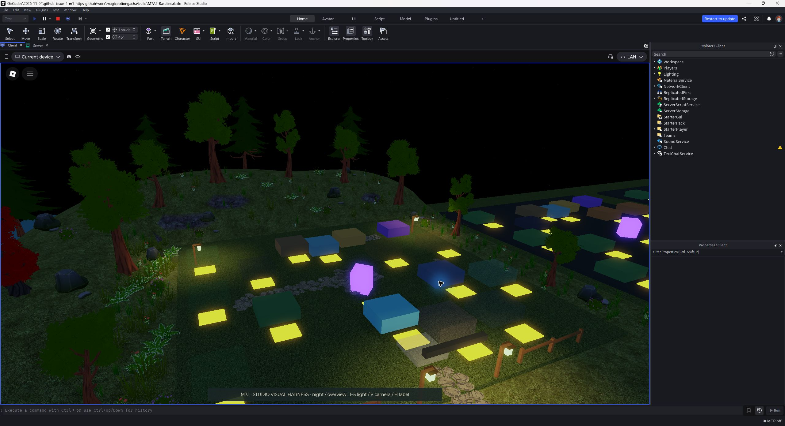 | 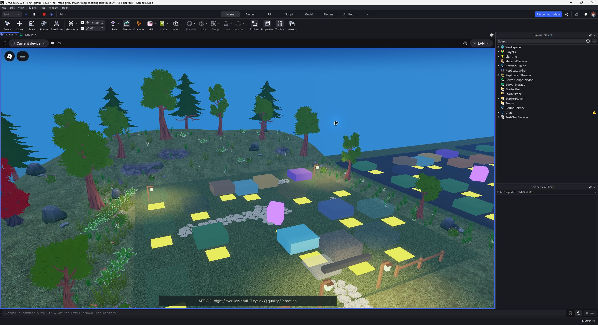 |

Settings proofs: [before Automatic](before-settings-auto.jpg),
[after Automatic](after-settings-auto.jpg), [before Manual 5](before-settings-low5.jpg),
[after Manual 5](after-settings-low5.jpg).

| Path close-up, Manual 5 | Foliage close-up, Manual 5 |
| --- | --- |
| 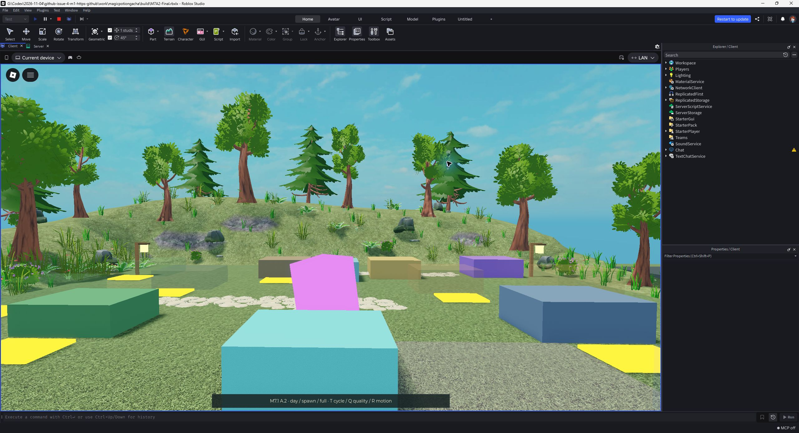 | 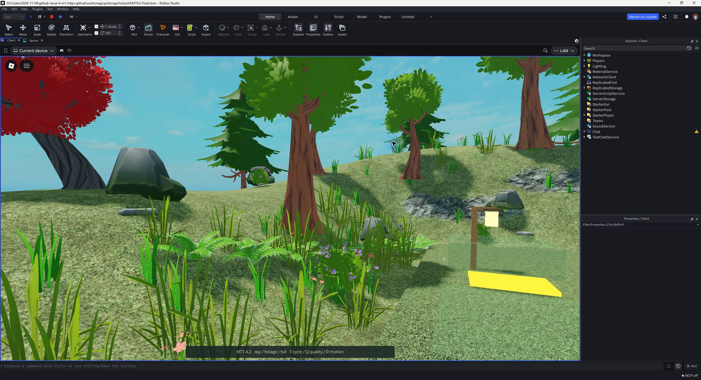 |

## Full-game Play, actual HUD

Separate disposable full-game build, memory-only Studio profiles, commerce off.
Automatic graphics, environment Reduced (default); actual character, HUD and
contextual labels retained. Z/X only set the lighting pose and review camera.
This is visual integration evidence, not acceptance of #18 UX or backend systems.
[Full-game settings proof](gameplay-settings-auto.jpg).

| Day | Night |
| --- | --- |
| 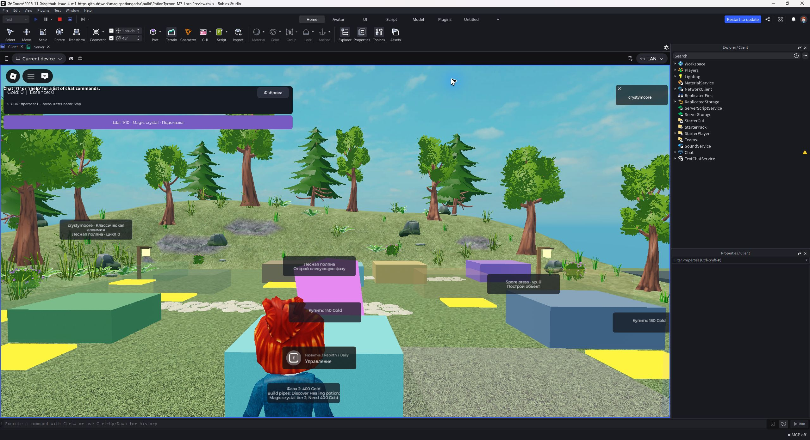 | 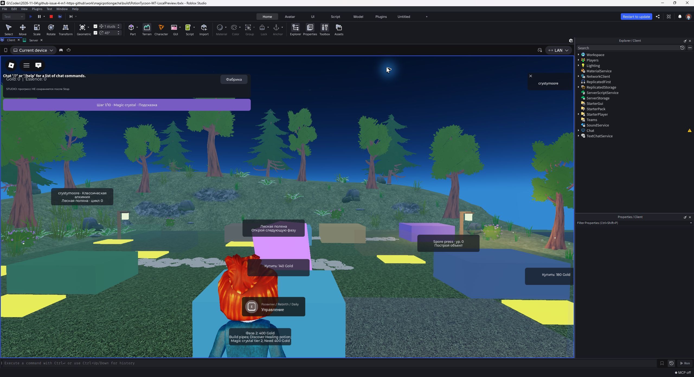 |

## Motion deliverable and engine audit

Run `node scripts/setup-tools.mjs` then `node scripts/check.mjs`. Open
`build/M7PilotReview.rbxlx` in Studio, Play, **T**: a repeating **45-second**
preview with sunset, night, dawn, rain and clearing. **1–5** select still states,
**V** changes camera, **Q** changes effect tier, **R** toggles Reduce Motion,
**P** prints active counts. Compare the result with this gallery; do not publish.
The same preview is included in the CI build artifacts.

The running cycle was sampled over 52 seconds: changing directional light,
night lamps/motes, rain and the next cycle were observed. A **recorded video is
BLOCKED / not supplied**; available native capture returns stills, and no recorder
was available in the inspected toolchain. Sparse screenshots do not prove smooth
animation or absence of temporal flicker. The executable preview is supplied
for that review, as permitted by Issue #20.

[Studio audit excerpt](studio-audit.txt) confirms a single lighting owner,
full/reduced/minimal caps, Reduce Motion, stop twice and Lighting restoration.
Observed active counts at the overview: Full 6 lights / 60 drops / 24 motes /
12 wind meshes; Reduced 3 / 24 / 9 / 1; Minimal zero. The configured reduced
wind cap is 4; distance/detail culling left only one eligible in this view.
ParticleEmitter count is zero; drops/motes are pooled Parts. These are not FPS,
draw-call or total-instance measurements.

For full-game reproduction run `node scripts/build-local-preview.mjs`, open
`build/PotionTycoon-M7-LocalPreview.rbxlx`, Play, **Z/X** for day/night, **C** for
normal camera and server-time weather. QA controls are absent from release.

## Diagnostic captures (not final-state approval)

[Investigation and limits](../../M7_A2_ATMOSPHERE.md#low-quality-investigation).
All interventions below were discarded on Stop; only the path's SmoothPlastic
material was retained in final source. `iteration4-sunset.jpg` is an older
candidate, deliberately excluded from the five final states.

- [Path material](diagnostic-low5-smooth-material.jpg): less fine grain; partial mitigation.
- [Shadow experiment](diagnostic-low5-no-shadows.jpg): inconclusive command-context configuration mutation; not proof of disabled live shadows.
- [Raised paths](diagnostic-low5-raised-path.jpg): distant marks remain.
- [Single-sided stones](diagnostic-low5-single-sided.jpg): missing triangles; rejected.
- [Thicker stones](diagnostic-low5-thicker-stones.jpg): craggy sides, no complete repair; rejected.
- [Leaf SurfaceAppearance removed](diagnostic-low5-no-leaf-surface.jpg): opaque light/dark card patterns remain; rejected.

Actual-phone FPS/thermals, 2–8 players, published asset permissions, DataStore,
PolicyService and purchase/trade/Rebirth backend acceptance remain BLOCKED.
