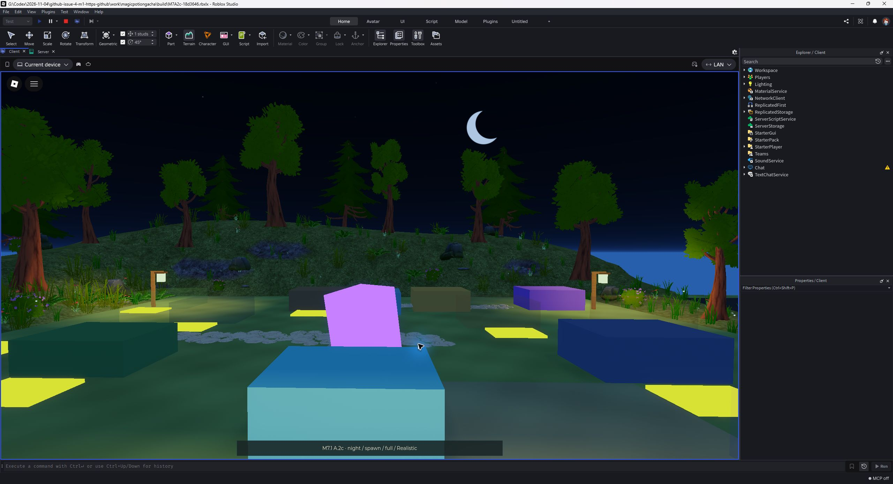

# A.2c — real Studio review, Gate A pending

**Owner decision required: APPROVED or specific changes.** This is only the
A.2c atmosphere patch. #18 UI and #19 island have not started.

Studio **0.746.0.7461264**, Windows desktop, 2026-11-05. All images are raw Studio
window JPEGs. No generated mockups, image retouching or color corrections.
Comparison camera: spawn, position `(-141,9,-36)`, target `(-143,7,-96)`, FOV 53.
Both versions use Full effects, the same viewport and explicit manual quality.
Cloud locations and small effect positions are not frame-synchronized.

## Matched comparisons

| State | A.2b / graphics 5 | A.2c / graphics 5 | A.2b / graphics 10 | A.2c / graphics 10 |
| --- | --- | --- | --- | --- |
| Dawn | [Before](before-5-dawn.jpg) | [After](after-5-dawn.jpg) | [Before](before-10-dawn.jpg) | [After](after-10-dawn.jpg) |
| Sunset | [Before](before-5-sunset.jpg) | [After](after-5-sunset.jpg) | [Before](before-10-sunset.jpg) | [After](after-10-sunset.jpg) |
| Night | [Before](before-5-night.jpg) | [After](after-5-night.jpg) | [Before](before-10-night.jpg) | [After](after-10-night.jpg) |
| Rain | [Before](before-5-rain.jpg) | [After](after-5-rain.jpg) | [Before](before-10-rain.jpg) | [After](after-10-rain.jpg) |
| After rain | [Before](before-5-afterrain.jpg) | [After](after-5-afterrain.jpg) | [Before](before-10-afterrain.jpg) | [After](after-10-afterrain.jpg) |

Settings proof: [before 5](before-settings-5.jpg), [before 10](before-settings-10.jpg),
[after 5](after-settings-5.jpg), [after 10](after-settings-10.jpg).

## Full game, original UI

[Ordinary Custom camera / default Reduced](gameplay-5-reduced-ordinary.jpg),
[night](gameplay-5-reduced-night.jpg), [dawn](gameplay-5-reduced-dawn.jpg),
[rain](gameplay-5-reduced-rain.jpg), [after rain](gameplay-5-reduced-afterrain.jpg),
[Full rain](gameplay-5-full-rain.jpg), [Full after rain](gameplay-5-full-afterrain.jpg).
All at [manual graphics 5](gameplay-settings-5.jpg). Named weather views use the
review helper's fixed camera inside the actual game; the ordinary capture uses
the normal player camera. The production server scripts and UI run with local
memory progress. This is not a real-backend or multiplayer test.

The moon and localized dawn mist remain recognizable on Reduced. Original
billboards still overlap and yellow pads are intrusive; these are shown openly,
not hidden for a gameplay acceptance claim. UI fixes wait for Gate A.

## Video and temporal limits

[45-second native Studio recording](atmosphere-cycle-45s.mp4): Full, manual 5,
spawn camera. T starts the deterministic 45s cycle. This is one continuous native
F12 recording segment, trimmed from seconds 259–304 of its source, with silent
H264 transcoding. No compositing, speed changes, frame interpolation or grading.
30 fps output may duplicate/drop native recorder frames. Duration is 45.00s.

Nine extracted frames were inspected. A 64×34 grayscale temporal diagnostic across
all 1,350 output frames found maximum adjacent-frame mean absolute delta 2.1719/255
and maximum mean-luma delta 2.1608/255. No large full-scene flash is evident in that
limited check; fine foliage flicker and all possible temporal artifacts are **not
certified absent**. See the actual video rather than treating this metric as art
approval or a phone performance measurement.

## Diagnosis and open items

The [Grass probe](probe-day-grass.jpg) and [SmoothPlastic probe](probe-day-smooth-confirmed.jpg)
use the same view/light/geometry at manual 10. Removing native Grass shading
substantially removes the flat floor grain. Final comparisons above demonstrate
the selected solution at manual 5 as well. The [native night probe](probe-night-native.jpg)
and [no Atmosphere/Clouds probe](probe-night-no-air.jpg) are diagnostic only, not
final build captures. They do not establish haze as the moon's root cause.

Open: fine grass alpha edges, native Grass hill grain, thin path-edge artifacts,
intrusive billboards/yellow pads. Moon scale and the dawn/afterrain treatment await
owner artistic review. The six-face skybox is unchanged from A.2b.

**BLOCKED:** physical smartphones, experience asset permissions and multiplayer
load. Local CC0 provenance/loading is verified, Roblox experience rights are not.
No real purchases, public trading activation, merge or game publication.

## Exact provenance

- Captured A.2c runtime: `18d36466f86f4a0bf9b4d3723482dac5b313c751`.
- Freshly re-opened A.2b runtime: `39788eafaf93de4c21f7817f0aff4cb4e38ffd35`.
- PR HEAD at task start: `4b372174088c6e5f6a5440846d233f1bd9d31ce4`.
- Captured A.2c place SHA-256: `53ef5c3cd55303646134328a14da0f042af509d0a30a4ad50fff10b1b2a7d1a9`.
- Captured full-game place SHA-256: `56b31d07e79cfc47a72a7a4f10abc2e6521015b4777836d684f748e7b2201609`.
- A.2b place SHA-256: `d1db8c61071e6f40b0fd2465c26455be81210c913f31e4c1beb3c123ef9e95a1`.

[Manifest / hashes](captures.json), [exact normalized source snapshot](source-snapshot.json),
[sanitized actual Studio audits](studio-audit.txt), [implementation and limits](../../M7_A2C_ATMOSPHERE.md).
867 tests retain all 859 existing cases. [Windows + Ubuntu runtime CI](https://github.com/branch-danya-dev/magicpotiongacha/actions/runs/42019252849)
passed after the license-byte fix, which did not change runtime or texture PNGs.
Final PR checks also verify these images/video/audit bytes and current runtime
against the captured snapshot. Draft remains ART PENDING.
