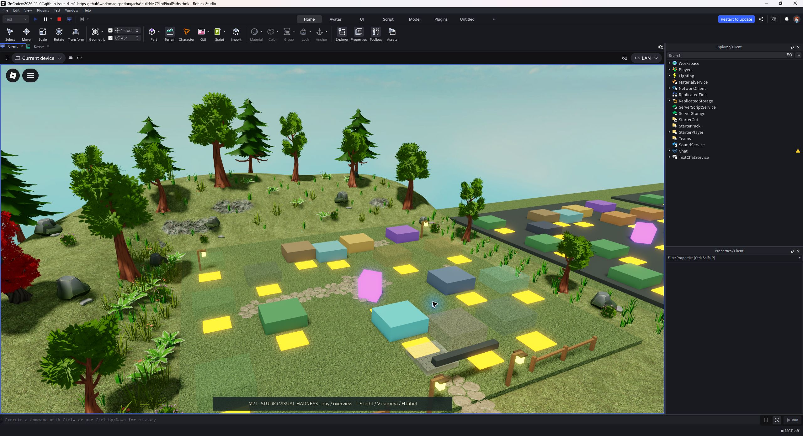
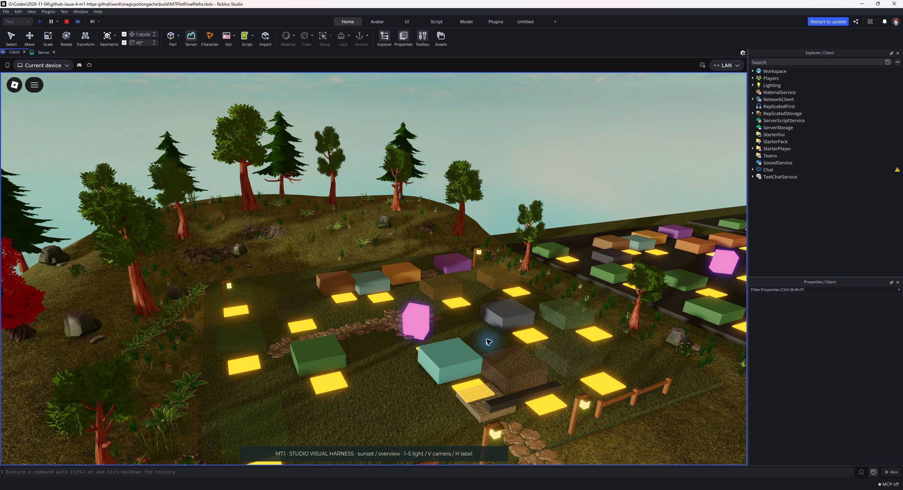
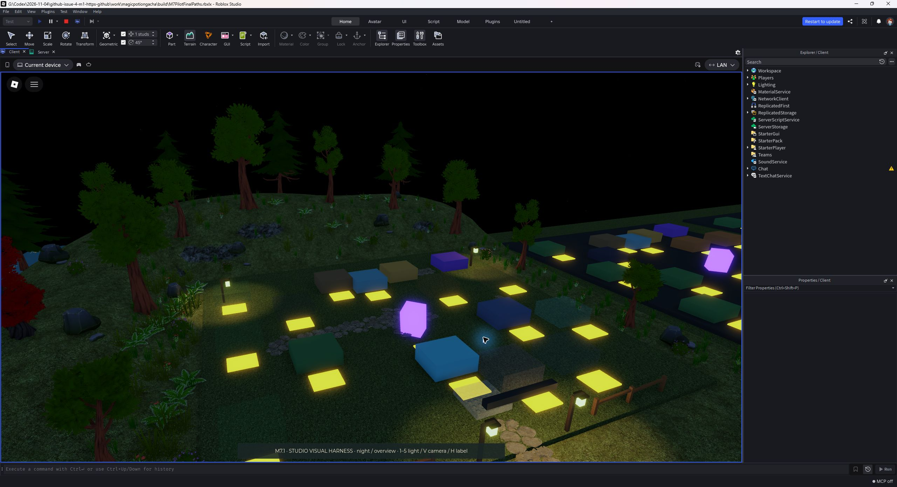
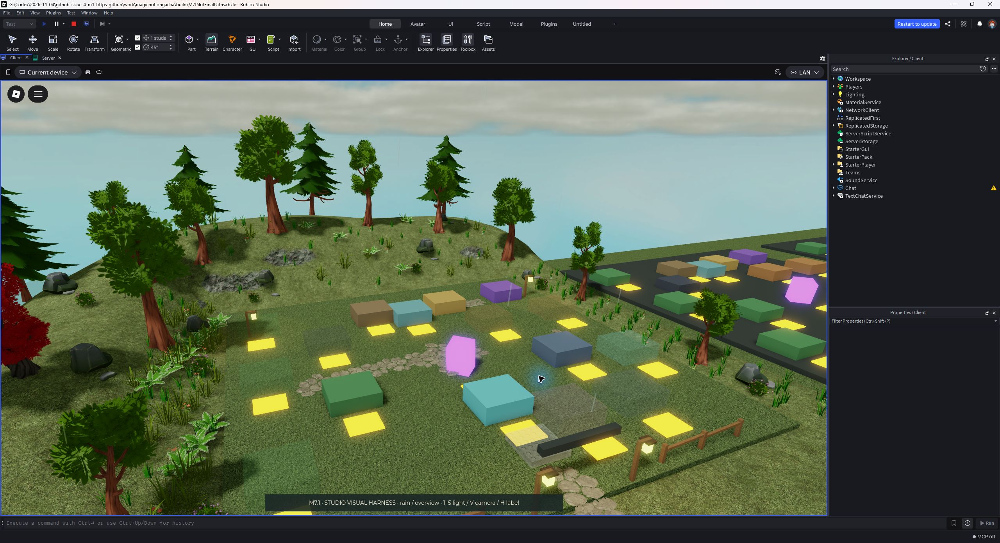
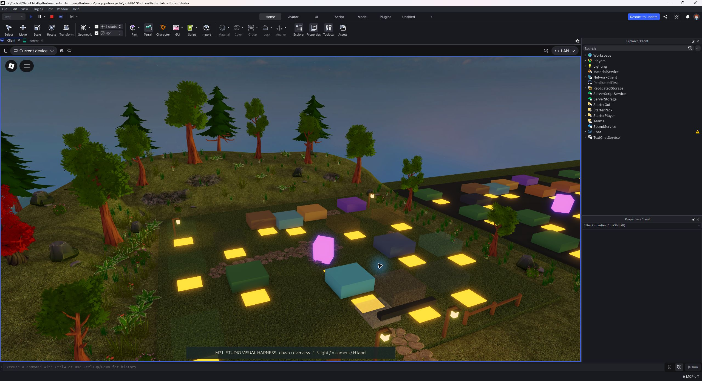
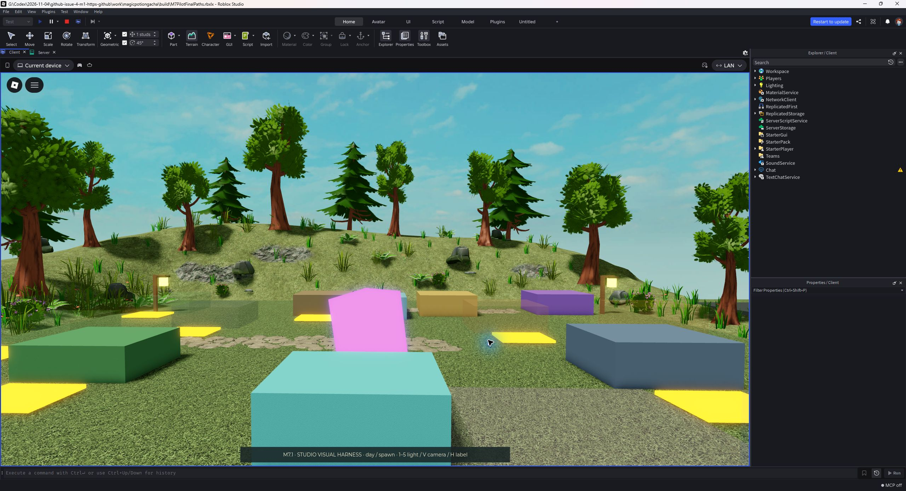
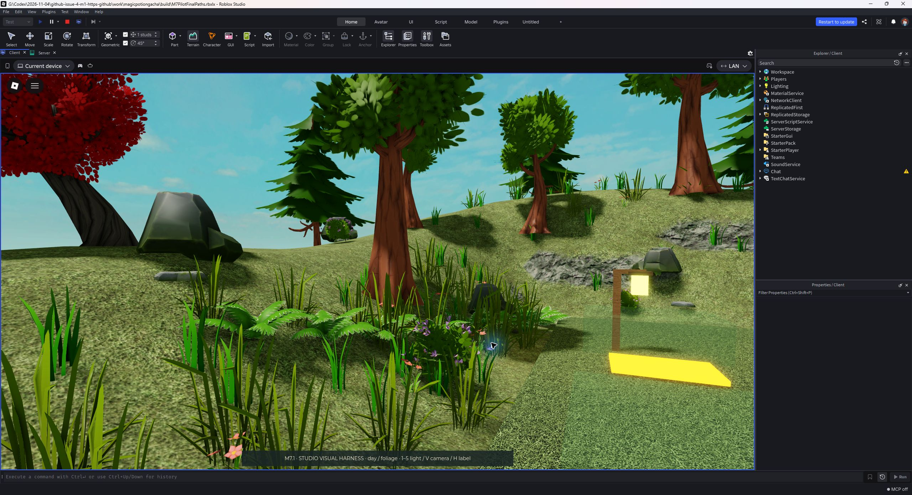
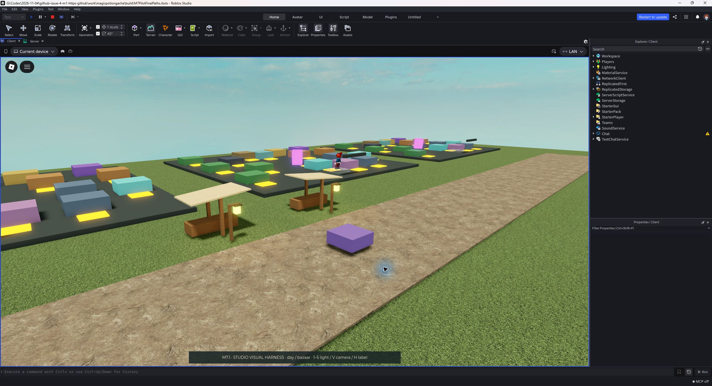
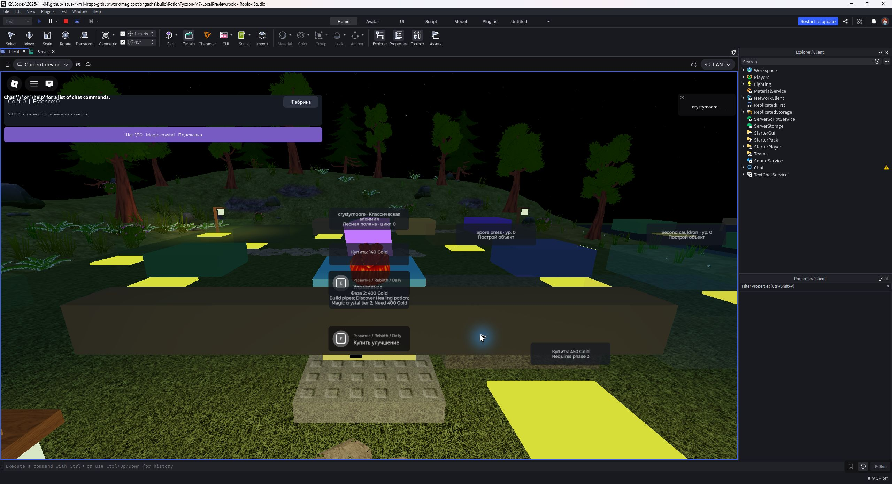
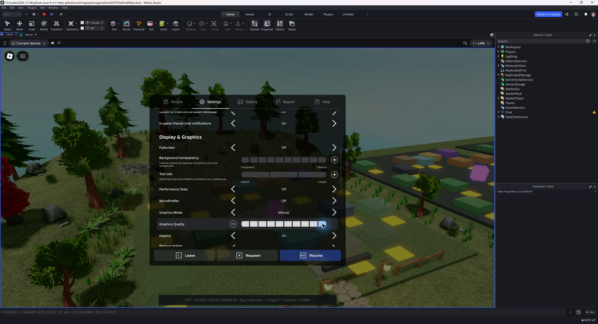

# Revised one-farm Studio evidence — owner review pending

These are unedited Roblox Studio captures of the replacement Quaternius pilot,
not reference renders. Studio 0.745.462.7451125, Future lighting. The five overview
views use the same 53-degree camera. Beauty views use the full environment preset
and Roblox **Manual graphics quality 10**; labels/prompts are hidden only in the
isolated harness. `gameplay-ui.jpg` is the full ordinary game with Automatic
graphics, the default reduced environment preset, normal UI and onboarding.

The previous primitive pilot remains ART REJECTED and is archived in `../m7/`.
This candidate still needs the owner's artistic decision. Issue #18 covers UX;
Issue #19 may extend the style only after ART APPROVED and the separate UX check.

## Observed checks and limits

- Imported 14 inspected CC0 models / 21 inert template MeshParts.
- Runtime: 432 decoration Parts, 8 plots, only 1 decorated; collision guards PASS.
- Rotated stone bounds do not overlap purchase pads; Terrain raycasts stay below
  the unchanged working floor. Art Parts do not collide or expose prompts.
- 116,626 authored triangles excludes Terrain, avatars and machines. Texture
  estimate 27.96 MiB RGBA8+mips is not a GPU measurement.
- **Open rendering issue:** Automatic/lower quality showed dark stippling on
  thin stones and foliage. It disappeared at Manual 10. The comparison series
  therefore pins 10; low-end/mobile rendering has not passed acceptance.
- The full-game capture proves a local startup with UI, not the complete player
  journey, backend, economy, mobile or multiplayer acceptance. Local progress is
  memory-only and commerce remains disabled. The existing labels overlap near
  spawn and remain work for the separate UX gate.
- Asset permissions on a second account/published experience, phone profiling,
  2–8 players and real backend checks remain unperformed. No publication/merge.

The [manifest](captures.json) seals exact source/image hashes and captured build
hashes. The repository integrity check detects source drift. Raw captures are
2560×1392 window JPEGs; no cropping, retouching, compositing or AI image generation.

## Views

### День

Общий вид участка.

### Закат

Та же камера, тёплый вечерний свет.

### Ночь

Та же камера, ночное освещение и фонари.

### Дождь

Та же камера, облачность и локальный дождь.

### Рассвет

Та же камера, утренний свет.

### Вход на участок

Камера со стороны входа; подписи скрыты в художественном стенде.

### Растительность вблизи

Реальные импортированные модели и текстуры.

### Образец базара

Два навеса; остальные семь участков остаются greybox.

### Обычная игра

Полная локальная сборка, штатный интерфейс и обучение, автоматическое качество.

### Настройки кадров

Художественные виды сняты на качестве Roblox Manual 10.

