# Issue #18 — Studio review evidence

**Artistic Gate A APPROVED. UI REVIEW PENDING. PR #17 remains Draft.**
No island #19, merge, game publishing, purchases or trade activation.

## Exact build

- Runtime source: `d6c836f5ea96269e20259b26fb7d173b2e8aa1f7`.
- Studio 0.746.0.7461264, Windows, single-player full-game Play.
- Local preview build SHA-256: `ef883f6a94fa867411745058ed20cca2413c7622095d811eee1aceb7c513a8f9`.
- [File hashes, source hashes and provenance](captures.json); [source snapshot](source-snapshot.json).
- [892-test log](checks-892.log), all 867 inherited tests retained + 25 UI tests.
- [Windows + Ubuntu runtime CI](https://github.com/branch-danya-dev/magicpotiongacha/actions/runs/42034015882) passed.
- All 98 Luau sources compile; portable modules analyze; production and visual Rojo builds pass.
  On this host the package scripts were executed directly with Node (npm was not on PATH).

## What the evidence demonstrates

The full game's own interface is visible. No beauty-mode hiding or QA overlay is used.
The local review helper only selects time/weather poses and character/camera checkpoints.
Profiles are local memory only; production server source and release flags are unchanged.

| Actual exercise | Result / scope |
| --- | --- |
| Day / sunset / night, identical spawn camera | 1920×1080, default Reduced, manual graphics 5 |
| Desktop route | 1366×768; spawn → crystal → garden → upgrade → Bazaar → unclaimed neighbour |
| Crystal keyboard input | One E press, Essence 0→1 |
| Garden | X selected the station; E opened it; one manual-gather click advanced tutorial 2→3 |
| Upgrade panel | Live balance 0 Gold, cost 100, shortage 100; quick F intentionally does not bypass the native hold; panel opened through “Цена и условия” |
| Bazaar | Native E opens the existing disabled-trade panel |
| Neighbour | Unclaimed Plot_2; zero prompts, compact free-plot marker. Not a two-player ownership test |
| Phone portrait touch | Native prompt click, Essence 1→2; visible joystick and jump button |
| Phone rotation | Existing panel retained across landscape/portrait; close button works |
| Native chat | Desktop panel moves to the right; narrow-screen own UI yields and restores the same panel after chat closes |
| Sampled label counts | Zero world BillboardGui labels; at most one eligible native prompt; [audit](studio-audit.txt) |

Phone preset is iPhone 17 Pro at 874×402 / 402×874 device canvas. Roblox's actual camera
viewport after device cutouts is 750×382 / 402×778; the CoreUISafeInsets container is
750×324 / 402×720. These are **Studio emulator checks, not physical-phone results**.
Some candidates correctly disappear when their prompt would overlap the compact HUD;
camera movement is required to expose them. Native touch controls may disappear after
a keyboard audit key and return on touch. The saved touch-action images precede that key.

## Recording

[Native Studio route recording, review copy](studio-route-review.mp4) — 6m52.4s.
F12 captured the real game viewport. The encoder stores 1360×768 although the Studio
camera reports 1366×768. H264 recompression, audio removal and device-metadata removal
are the only processing; no cuts, acceleration, recoloring or generated frames.
The original 97,580,621-byte recording remains in the local output package.

Approximate navigation: 00:00 spawn; 00:16 crystal; 00:44 garden; 04:45 station
selection; 05:05 gather; 05:35 price; 06:05 Bazaar; 06:30 free neighbour.
The long pause is the actual review workflow. Nine decoded samples were inspected.
The route uses QA checkpoints, **not a continuous walking traversal**.

## Open defects and acceptance boundaries

- **OPEN:** a native desktop player list carried into portrait emulation overlaps the
  Factory button. The defect image is retained. The other portrait images were taken
  after manually closing that list with its native X; this is not an automatic fix.
- Mixed Russian/English labels remain in inherited pages. Greybox station geometry,
  crystal, Bazaar marker and the seven non-pilot plots remain visibly unfinished;
  station art and island construction were not silently expanded into this patch.
- **BLOCKED:** physical smartphone performance/touch/keyboard, experience asset rights,
  and 2–8-player load. Foreign-owned farm access, release/reclaim and reconnect still
  need live multiplayer verification. Pure/server tests do not substitute for it.
- Physical gamepad, every M1–M6 panel and the full production/progression loop have not
  received exhaustive live regression in this pass. The sampled actions showed no
  duplicate effect; no universal no-double-input certification is claimed.
- Full/Minimal/Reduce Motion were not rerun for this UI pass. Historical A.2c testing
  and inherited automated tests remain; Gate A environment settings did not change.
- Fine foliage/path shimmer and distant Terrain grain are inherited open visual limits.
  Studio logs also contain Rojo connection, plugin-update lock and backend telemetry
  warnings; a clean global engine/network log is not claimed. No game-script stack
  error was observed in the inspected final session.
- Historical R4/R6 screenshots in the local folder are earlier checks, not this exact
  runtime. Only the `final-*` captures listed in this manifest are attributed to it.

## Reproduce locally

1. Check out the runtime SHA, run `npm run tools`, then `npm test`.
2. Run `node scripts/install-atmosphere-preview.mjs` for the reviewed local textures,
   then `node scripts/build-local-preview.mjs --ui`.
3. Open `build/PotionTycoon-M7-LocalPreview.rbxlx` in Studio and Play. Do not publish it.
4. Use native Roblox settings to choose manual graphics 5. The default effect tier is Reduced.
5. F6 selects checkpoints, F8 returns to spawn, L cycles day/sunset/night/rain, P logs
   UI bounds/counts without adding an on-screen debug overlay. Actions use native UI.
6. Choose Studio device emulator Actual Resolution for the desktop sizes, then phone
   landscape/portrait. The production project excludes this review helper.

The user must review UI before #19. Gate A approval alone does not approve this UI,
asset deployment, multiplayer readiness, merge or publishing.

## Actual captures

### День · 1920×1080 · Reduced / графика 5

### Закат · та же камера · Reduced / графика 5

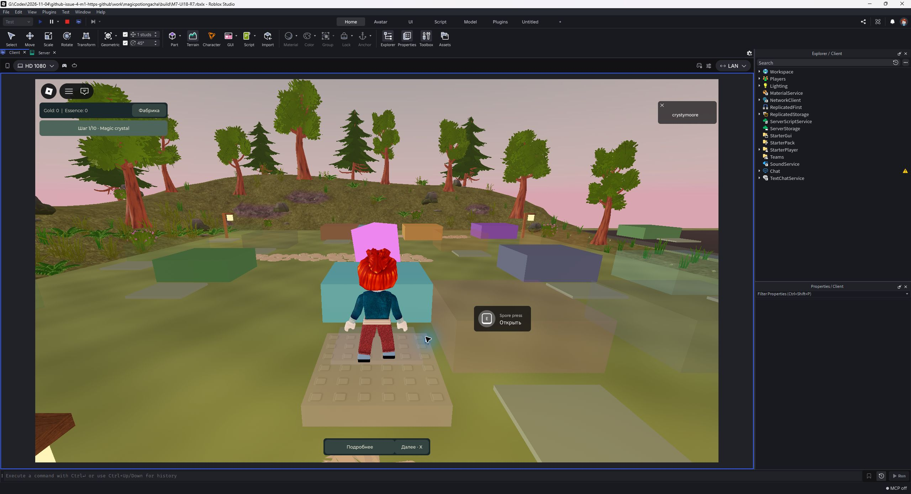

### Ночь · та же камера · Reduced / графика 5

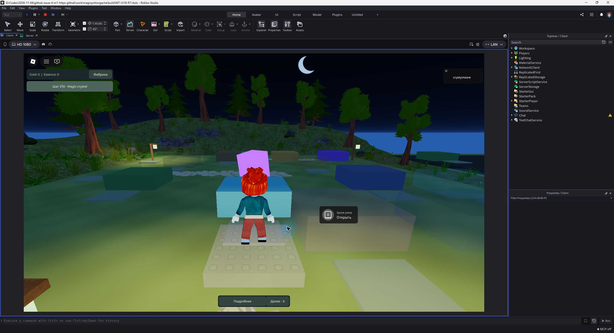

### Ночь · 1366×768 · обычный Play

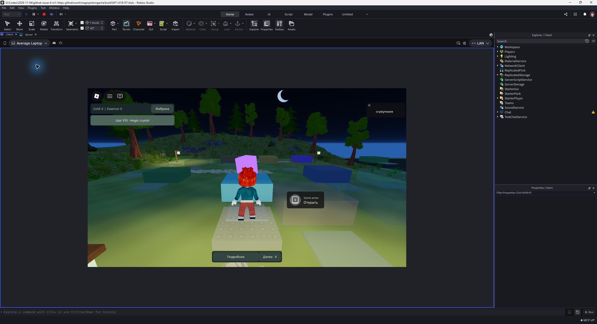

### Панель станка ночью

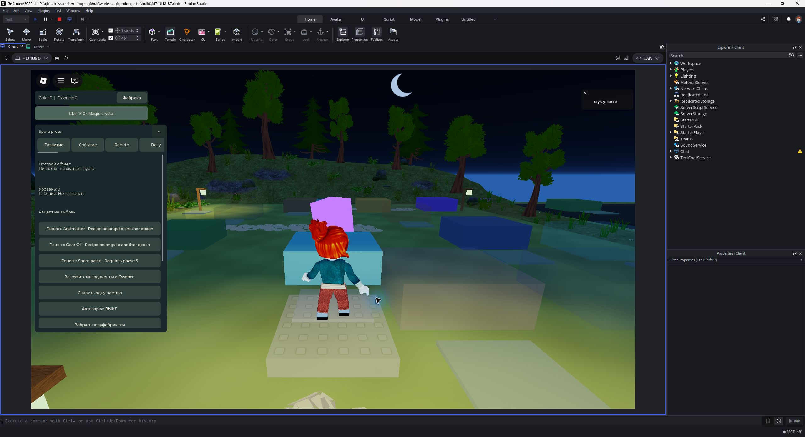

### Открытый чат: панель сдвинута вправо · графика 10

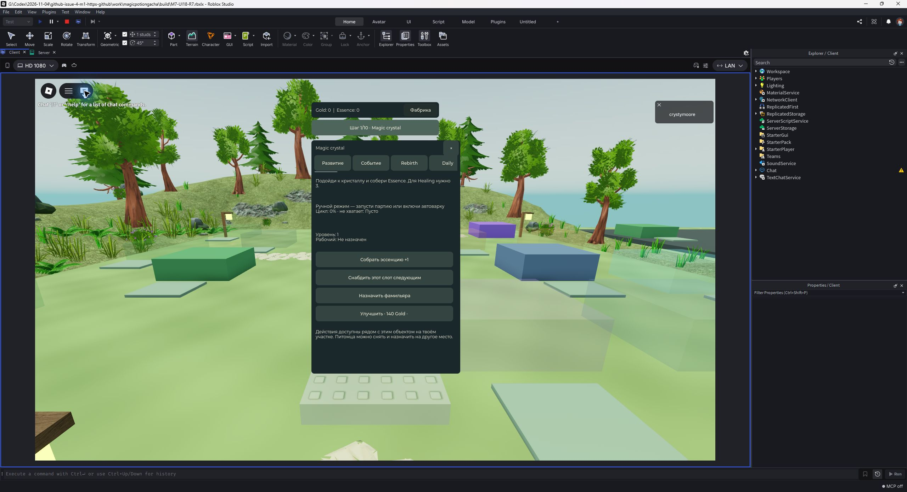

### Закрытие панели при открытом чате · графика 10

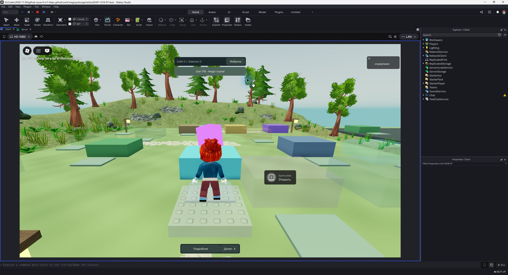

### Клавиатура: Essence 0 → 1

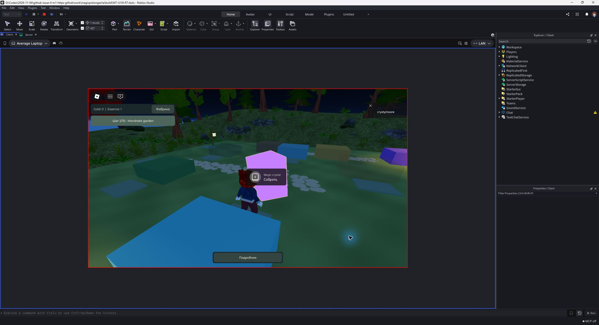

### Сбор вручную: обучение 2 → 3

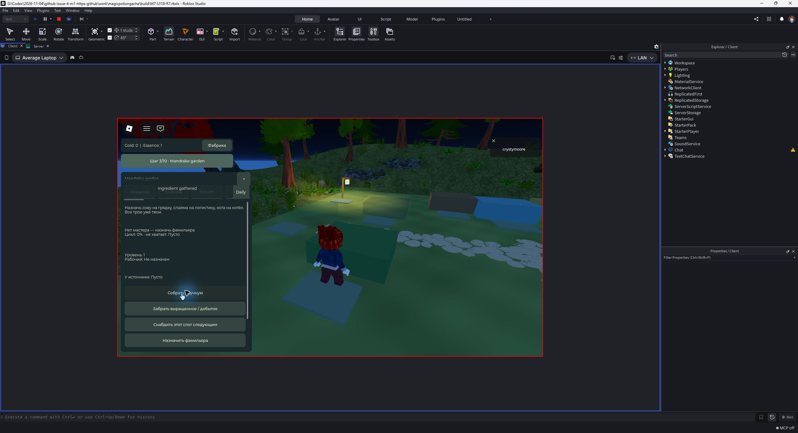

### Цена улучшения и недостающие 100 Gold

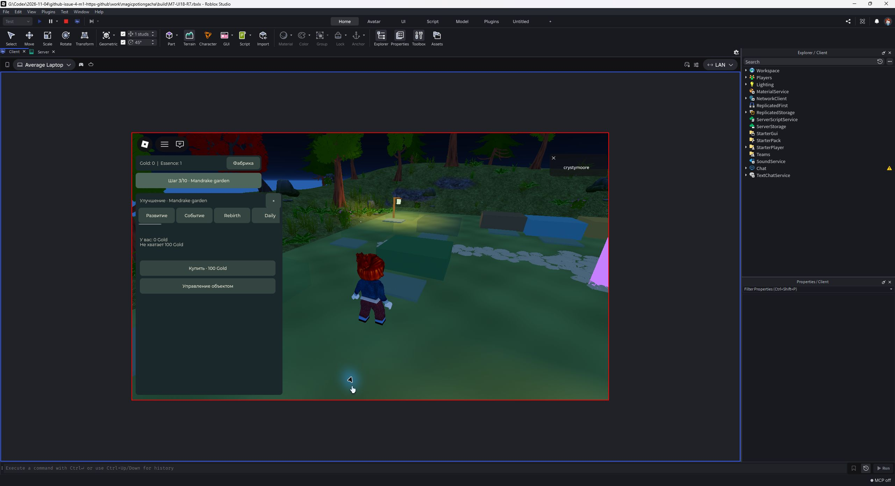

### Базар: публичная торговля остаётся выключенной

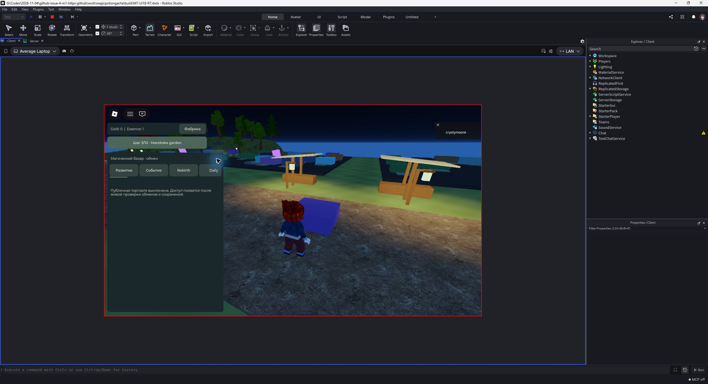

### Свободный соседний участок: нет доступных действий

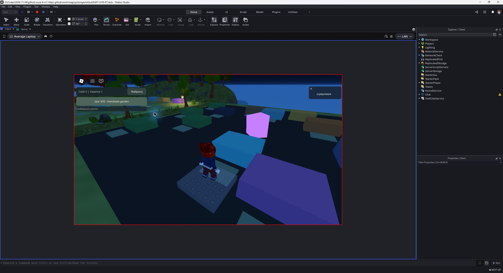

### Эмулятор телефона · горизонтально · Reduced / 5

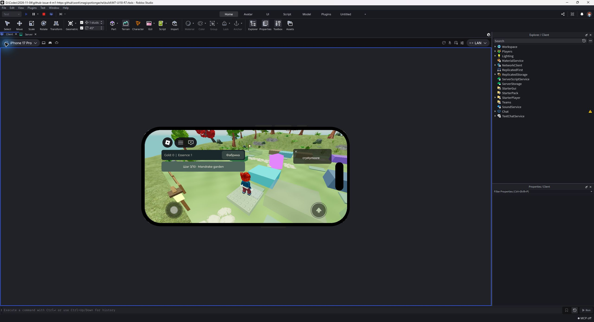

### Горизонтальная панель оставляет место управлению

### Открытый чат: интерфейс игры временно уступает место

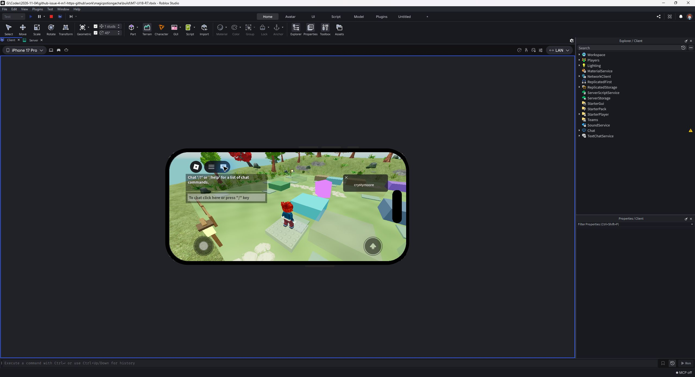

### После закрытия чата восстановлена прежняя панель

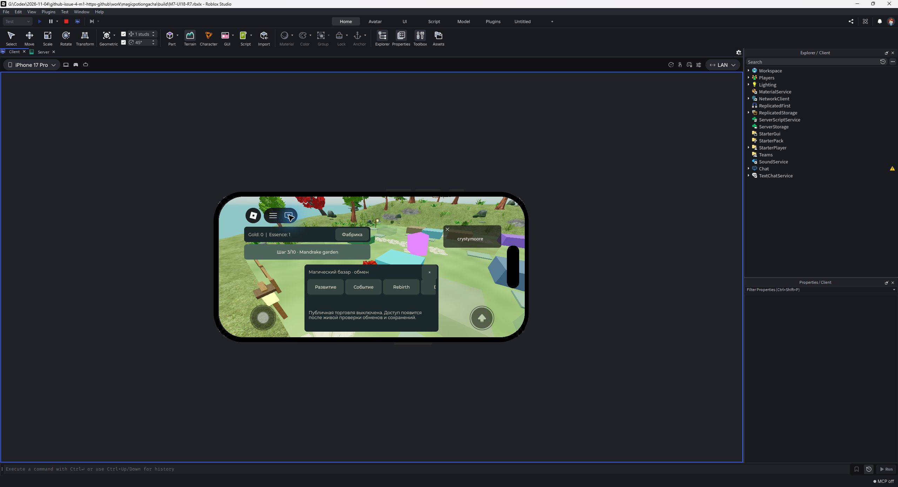

### Портретная панель после поворота · список игроков закрыт вручную

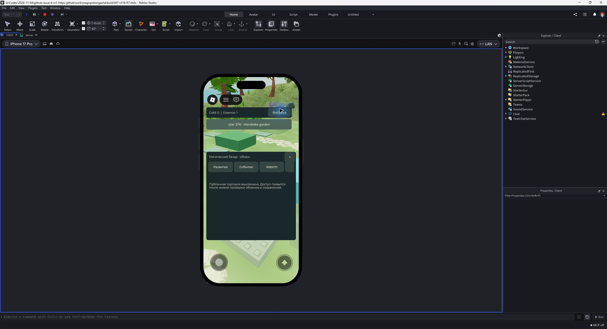

### Портретный экран без панели

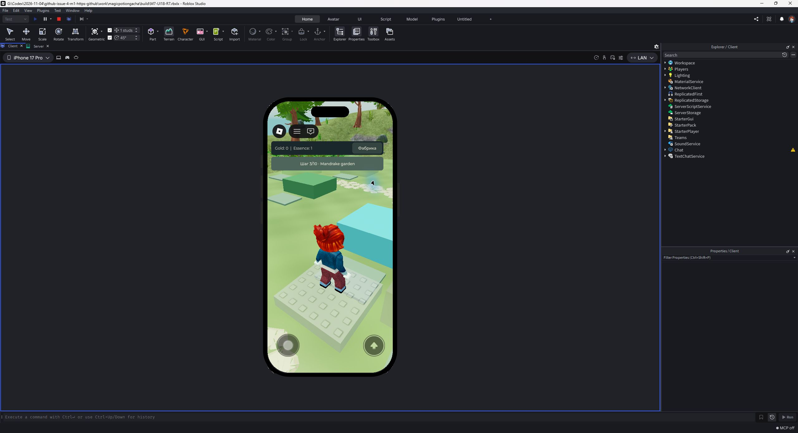

### Сенсорная кнопка: Essence 1 → 2

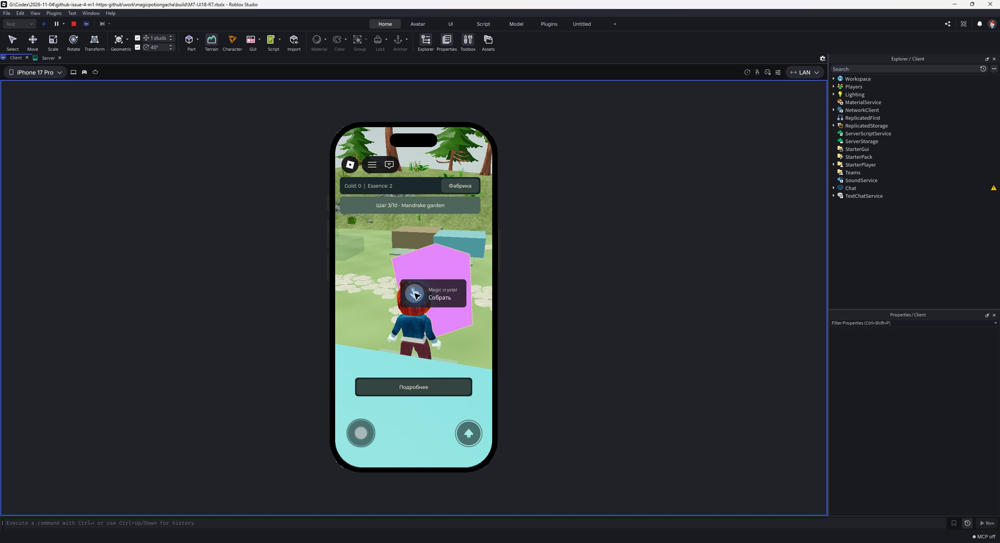

### OPEN: перенесённый с ПК список игроков перекрывает «Фабрика»

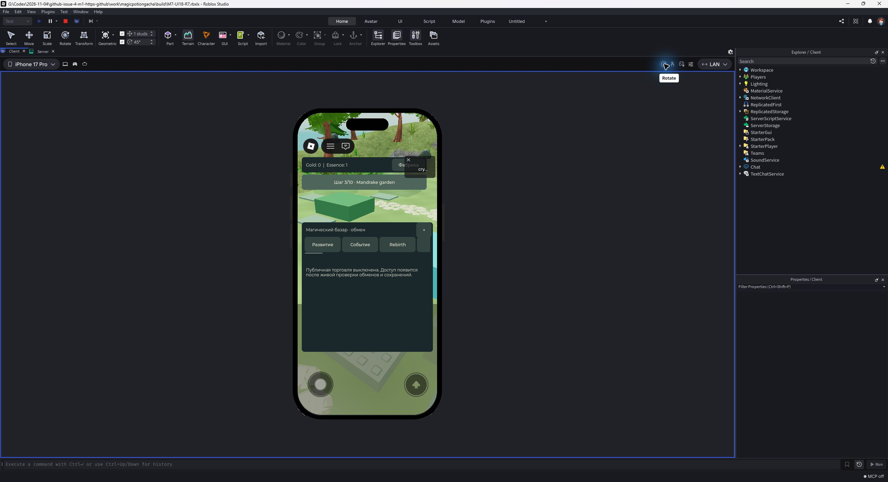

### Фактически выбранная ручная графика 5

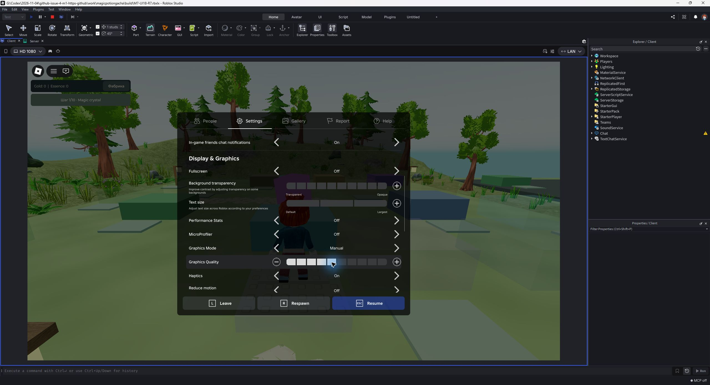
