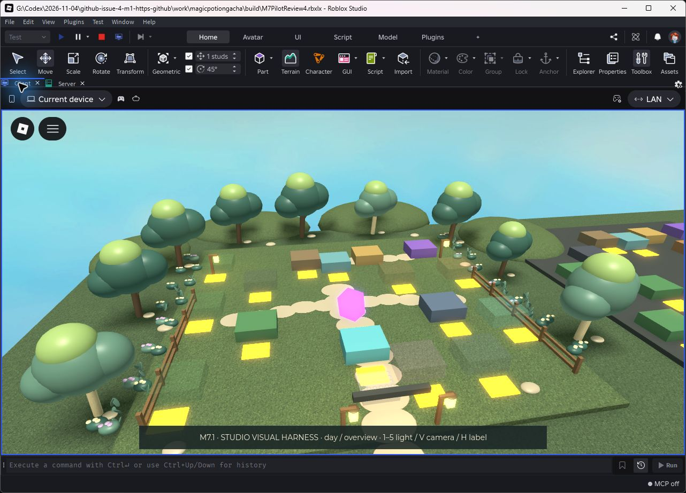
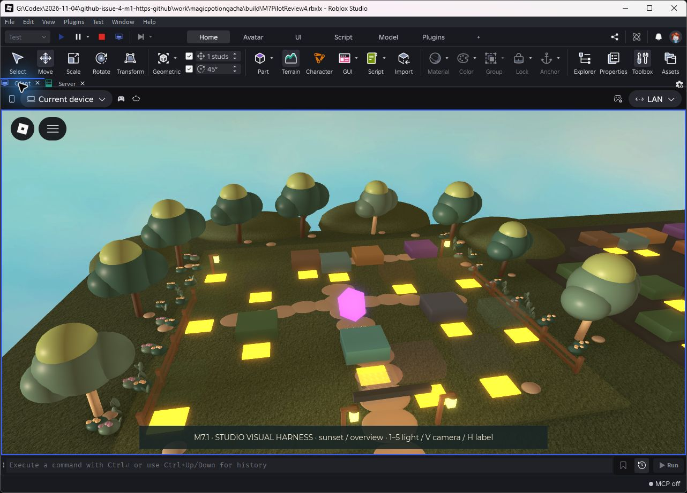
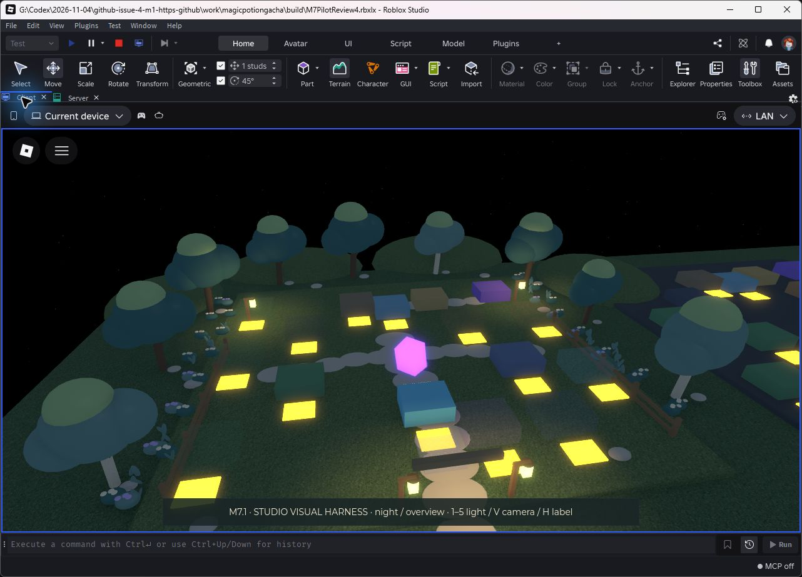
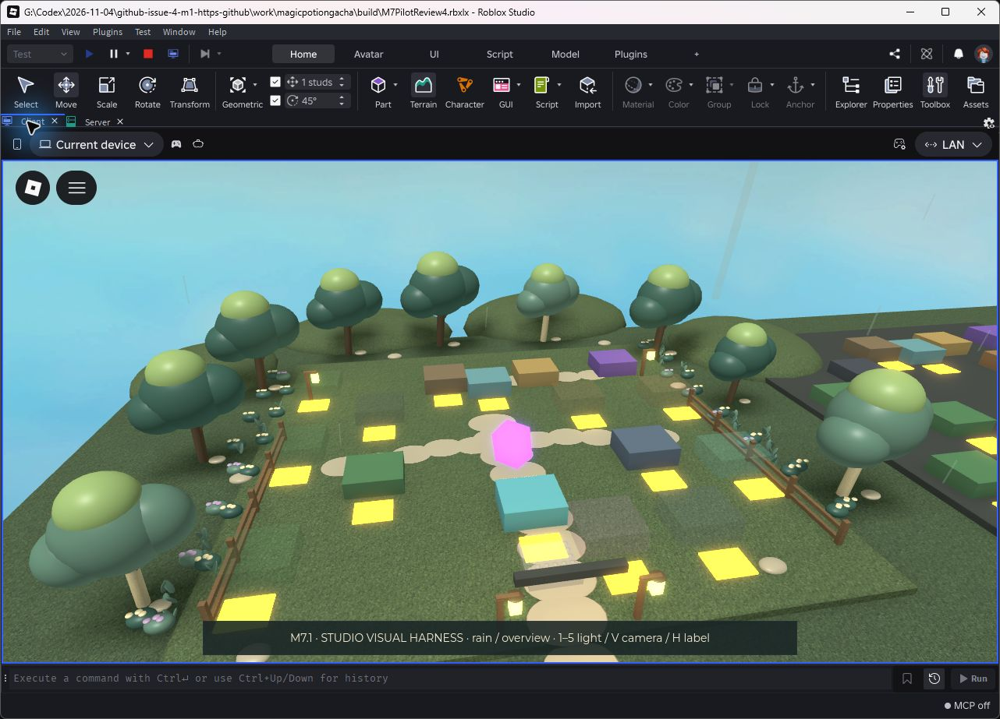

# M7.1 / Gate A — Studio review evidence

**ART REJECTED by the owner on 2026-11-05.** These are historical first-pass
captures, retained for before/after comparison. They do not pass the ordinary
gameplay UI gate (#18). The revised Gate A direction is in
[M7_ART_DIRECTION.md](../../M7_ART_DIRECTION.md); no new Studio captures are claimed.

Actual unedited Roblox Studio captures, 2026-11-05 (Moscow), Studio
0.745.462.7451125, full quality. **Original native fallback**, not imported
Quaternius or an accepted final art pass. Other seven plots remain greybox.

All images use the fourth local visual harness build, SHA-256
`b8fd4f81cb6896dcf935bfa58d0335bfe90bd3795a32f1b2a5fe23be3b8120e6`.
It is byte-identical to the final local `build/M7PilotReview.rbxlx`.
`captures.json` records source and screenshot hashes. Same overview camera and
field of view in the five lighting captures; foliage/rain animation is live.
Annotations are hidden only for beauty captures. The last three images show the
same contextual billboard selection used by the actual environment controller.

| State / view | Capture |
| --- | --- |
| Day / overview | [01](01-day-overview.jpg) |
| Golden sunset / overview | [02](02-sunset-overview.jpg) |
| Soft night / overview | [03](03-night-overview.jpg) |
| Light rain / overview | [04](04-rain-overview.jpg) |
| Dawn / overview | [05](05-dawn-overview.jpg) |
| Day / spawn | [06](06-day-spawn.jpg) |
| Day / Bazaar framing | [07](07-day-bazaar.jpg) |
| Day / spawn / contextual annotations | [08](08-day-spawn-annotations-audit.jpg) |
| Day / Bazaar / QA-closed notice | [09](09-day-bazaar-annotations-audit.jpg) |
| Sunset / overview / contextual annotations | [10](10-sunset-labels.jpg) |

The isolated harness constructs the existing eight logical plots and paints only
one. The server verified 358 decoration Parts, anchored/noncolliding/nontouchable/
nonqueryable and no decorative prompts. No M7 script exception was found. The
renderer reported a cloud shader warning; no hardware cloud/FPS claim is made.
This harness has no profile persistence, purchase/trade runtime, economic actions
or freely moving gameplay camera, so it cannot pass those acceptance gates.

Review palette, tree shapes, density, warm paths, night visibility and the fit of
the work zones. CC0 import is BLOCKED by the public download quota and unavailable
verified-package tooling. Owner visual decision is PENDING; full eight-plot
rollout remains withheld. See [acceptance matrix](../../M7_ENVIRONMENT.md).
